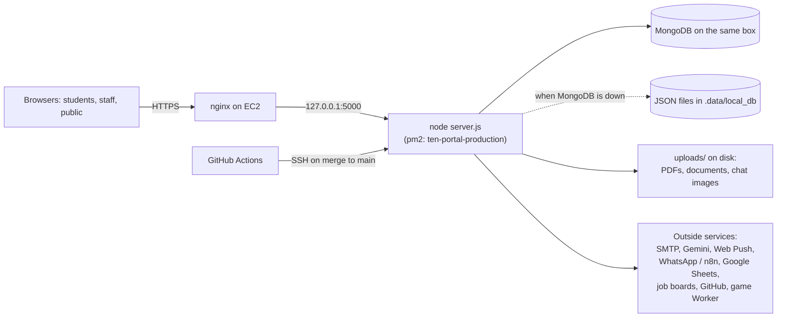

# TEN Portal — Handover

This is the document to read if you are taking over the TEN internship portal.
It explains what the portal does, how it runs, how changes reach production,
and what is unfinished. It also says which parts of the code to be careful
with.

- **Written:** 21 November 2026, against `main` at commit `e77ed0f` (PR #270).
- **How:** by reading the code. Older documents were not copied. Where the
  code could not settle something (usually because the answer is in the
  server's `.env`), it is marked **UNSURE**, with a way to check it.
- **The code wins.** When this document and the code disagree, the code is
  right and this document should be corrected in the same PR.

**Suggested reading order for your first day:** §1 (what it is), §2 (the
access you need), §3 (architecture), §13 (deploying), §15 (working rules),
§17 (known problems). Use the rest as reference.

## Contents

1. [What the portal is](#1-what-the-portal-is)
2. [Access the owner must hand over](#2-access-the-owner-must-hand-over)
3. [Architecture](#3-architecture)
4. [Repository map](#4-repository-map)
5. [Users, roles and sign-in](#5-users-roles-and-sign-in)
6. [Pages and portals](#6-pages-and-portals)
7. [Features, area by area](#7-features-area-by-area)
8. [Data model](#8-data-model)
9. [Files on disk](#9-files-on-disk)
10. [Scheduled and background work](#10-scheduled-and-background-work)
11. [Outside services, email and money](#11-outside-services-email-and-money)
12. [Configuration (`.env`)](#12-configuration-env)
13. [Deploying](#13-deploying)
14. [Running the server](#14-running-the-server)
15. [Working on the code](#15-working-on-the-code)
16. [History](#16-history)
17. [Known problems and open work](#17-known-problems-and-open-work)
18. [Which older documents to trust](#18-which-older-documents-to-trust)
19. [Glossary](#19-glossary)

---

## 1. What the portal is

The Entrepreneurship Network (TEN) runs **virtual internships**. Students pick
an internship **domain** (web development, data science, HR, finance, …) and a
**tenure** (1 week to 6 months). Every week they do tasks, take quizzes and mark
attendance. At the end they get documents: an offer letter, a letter of
completion, a letter of recommendation, and certificates. Each document has a
number that anyone can verify publicly.

Production: **https://virtualinternships.entrepreneurshipnetwork.net**

Around that core, the same codebase serves:

| Product | For | Section |
|---|---|---|
| Internship portal (student dashboard, tasks, attendance, documents) | interns | §7.1 |
| HR portal and coordinator dashboard | TEN staff | §7.2–7.3 |
| Admin console (`/ten-admin`) | the single TEN admin | §7.4 |
| Founder OS, mentor, investor and contractor desks, directories | the wider TEN ecosystem | §7.5 |
| Academics, the LLM portal (`/learn`), Career Studio, Job portal, Resume portal (TEN Resume AI), Hackathon portal, TEN Assistant | paying or extra products | §7.6 |
| Growth OS (`/growth`) with the college outreach agent | the growth team: email campaigns to students and colleges | §7.7 |
| Coins, marketplace, DAO voting | gamification | §7.8 |

**Domains.** The canonical list is `config/domains.js`: 19 domains, 15 of them
open to new students. Employee IDs, task tracks, chat rooms and groups are all
keyed on the domain.

**Money.** Some tenures are paid: 1 Week ₹2,000, 15 Days ₹1,500, 1 Month ₹1,000.
The others are free, and students registered before 9 July 2026 are exempt.
Career Studio products cost ₹150–₹500, and some certificates carry a fee.
Payment is a UPI transfer: the student types the bank reference (UTR) and
**a person approves it** (§7.9). The owner has ruled out adding a payment
gateway such as Razorpay for now.

**Scale (November 2026).** The weekly activity mail reaches about 1,550
students (comment in `server.js`). The certificate migration in this month
covered 1,757 student records with certificate data. Everything runs on **one
EC2 machine**. The owner's ceiling for all infrastructure together is
**₹3,000 a month**.

---

## 2. Access the owner must hand over

None of these are in the repository, and none should ever be. Get each one
from the owner, then check it works. Values are never written down here.

| What | Why you need it | Where it lives |
|---|---|---|
| GitHub: admin or maintain on `the-Entrepreneurship-Network/Ten-Ecosystem1` | Merging PRs is what deploys (§13) | GitHub |
| GitHub Actions secrets `EC2_HOST`, `EC2_SSH_USER`, `EC2_SSH_KEY`; optional repository variables `PROD_APP_DIR`, `STAGING_APP_DIR` | The deploy job logs in to the server with them | repo → Settings → Secrets and variables |
| AWS account with the EC2 instance; an SSH key for `ec2-user` | Logs, restarts, `.env`, MongoDB, disk | AWS console |
| The production `.env` | Every secret and setting (§12) | **only** on the server, in the app directory |
| The domain and its DNS | Moving or renewing the site | the owner's registrar or DNS provider |
| The SMTP account that sends all email | Mail stops when it lapses. **UNSURE which provider:** the code's default host is Brevo, `.env.example` describes AWS SES, and a comment mentions Sender.net. Run `node scripts/check-email.js` on the server; it shows the host without printing the password. | provider console |
| Google AI Studio (Gemini API key) | LLM-portal exams, the idea agent, Growth OS "Draft with AI", AI task feedback | Google account |
| The admin login (`ADMIN_USERNAME` / `ADMIN_PASSWORD_HASH`) and the Growth OS login (`GROWTH_USERNAME` / `GROWTH_PASSWORD_HASH`) | Each is a single account defined in `.env`, not in the database | `.env` |
| HR and coordinator roster passwords (`HR_CREDENTIALS`, `COORDINATOR_CREDENTIALS`) | Staff sign-in. The rosters are in `server.js`; the bcrypt hashes are in `.env` | `.env` (+ `credentials-to-distribute.txt` on the server if the setup script made one) |
| If used: Meta WhatsApp app / n8n webhook, Instantly.ai, the Cloudflare Worker running the Business Playground game, PaymentSetu or Setu merchant accounts | The features in §11 that depend on them | each provider |

**Never paste the contents of `.env`** into a chat, ticket, PR, log or
screenshot. See `docs/SECURITY-DO-NOT-EXPOSE.md`.

---

## 3. Architecture



**One process does everything.** `server.js` (about 12,200 lines) plus the
routers in `routes/` serve every page, every API, the Socket.IO chat, the
Server-Sent Events notification streams, and every scheduled job (§10). There
are no workers, queues or separate services.

**Request path.** The middleware order in `server.js` is: CORS (an allow-list
from `CORS_ALLOWED_ORIGINS`), the JSON body parser, the session (cookie
`ten.sid`, stored in MongoDB by connect-mongo v4), no-store headers on API and
staff paths, the service worker and manifests, the Career Studio page gate,
`express.static('public')`, the `/uploads` guard and static, helmet, the `/api`
rate limiter, then the routes. One thing follows from this order: **every file
in `public/` is reachable at `/<file>.html`**. A page that "requires login" is
protected by the APIs it calls, not by its URL. Only `/ten-admin`, `/growth`,
`/assistant` and the two Studio portals check on the server before serving the
page.

**MongoDB down is a mode, not a crash.** If MongoDB is unreachable, the app
keeps running against JSON files in `.data/local_db/`. Unique indexes are only
emulated there. Every page shows a banner, and `services/dbHealth.js` keeps
reconnecting. After an outage, `scripts/import-fallback-db.js` (dry run, then
`--write`) copies the rows written during the outage into MongoDB. The
production deploy warns if `/api/health/db` does not report `"connected":true`.
The fallback works by wrapping every model's query methods
(`wrapModelWithFileFallback` in `server.js`). A wrapped `exec` must go through
`utils/guardedExec.js`: populate calls `exec` with a callback, which returns
nothing, and chaining `.catch` onto that made every `.populate()` throw while
MongoDB was up.

**Frontend.** Most pages are plain HTML, CSS and JavaScript in `public/`. Four
products are React + Vite apps whose **built** output is committed to git
(§15.5): `job-portal-app/`, `resume-portal-app/`, `hackathon-portal-app/` and
`student-portal-app/`, built into `public/<name>/`.

**Realtime.**
- Chat runs on Socket.IO. Rooms are `domain_<D>`, `general`, staff rooms and
  `dm::a::b`. Messages are stored in `messages`; direct messages expire after
  30 days through a TTL index.
- Notifications are pushed over SSE (`/student-events`, `/coord-events`).
  Personal notifications are also sent by email and Web Push (§7.1).

---

## 4. Repository map

| Path | What it is |
|---|---|
| `server.js` | The app: startup, middleware, about 200 inline routes (legacy student, HR and coordinator APIs, attendance, chat, uploads, payments), the JSON fallback engine, Socket.IO, and several scheduled jobs |
| `routes/` | Routers mounted by `server.js`. `routes/v2/` holds the newer student portal, tasks, quiz, certificates, documents, payment, HR, Studio, learn, academics, resume and job agents, hackathons, marketplace, attendance agent, LinkedIn openings. Also at the top level: `growth.js` (Growth OS), `adminPortal.js` (admin API), `founderOS.js`, `dao.js`, `chatModeration.js`, `push.js`, `notificationFeed.js` |
| `controllers/` | Handlers for the register hub and the profile routes |
| `models/` | Mongoose schemas: 84 files, about 88 models. `models/new/` is a second generation (tasks, coins, quizzes, documents). `server.js` defines 8 more models inline (§8.1) |
| `services/` | Business logic: certificates and PDFs (`services/v2/*Service.js`, `certificateFile.js`), Growth OS (`growth*.js`), the college agent, the idea agent, the automation crons, email/push mirrors, payments, the resume and job engines |
| `middleware/` | Session and role guards (`sessionAuth.js`, `roleGuard.js`, `adminAuth.js`, `growthAuth.js`), the Studio gate, the tenure-fee gate |
| `config/` | Single sources of truth: `domains.js`, `tenurePayment.js`, `studioPricing.js`, `payment.js`, `growthQuota.js`, `growthTemplates.js`, `collegeSeeds.js`, `daoConfig.js`, `roles.js`, `secrets.js` (boot-time validation) |
| `utils/` | Mailer, Gemini client, tenure and attendance maths, employee IDs, document numbers, password storage, SSE hub, log throttling |
| `public/` | Every page, script, stylesheet and image, plus the built SPAs |
| `*-portal-app/` | Source of the four React apps (§15.5) |
| `scripts/` | Operations and migration scripts (§14.4). `scripts/server/` holds the MongoDB hardening script and the watchdog |
| `seeds/` | `domainTasks.seed.js` (task tracks) and `quizQuestions.seed.js` |
| `data/learn/` | The LLM-portal curriculum: 15 domain JSON files |
| `tests/` | About 165 Jest files (§15.4) |
| `docs/` | Older specifications and maps. Check §18 before trusting one |
| `.github/workflows/` | CI on pull requests; deploys to production and staging |
| `ecosystem.config.js` | pm2 process definitions (§13.1) |
| `poster-kit/`, `tools/` | Offline generators for the LinkedIn posters and the resume engine's data. Their output is committed |
| `project-assistant/` | A separate Next.js app. **Not deployed** anywhere |
| `artifacts/`, `scratch/`, `PUBLIC_FILE_PATH`, `metadata.json`, `bun.lock`, `sonar-project.properties` | Leftovers the running app does not use. `bun.lock` is stale: use `npm`, not bun |
| `notice.json` | **Live data** for the coordinator notice board, but tracked in git, so every deploy resets it (§17) |
| `.claude/skills/` | Instructions for Claude Code sessions, not loaded by the app |
| `CLAUDE.md` | The working rules for anyone changing this repo (§15.1) |

---

## 5. Users, roles and sign-in

### 5.1 Who can sign in, and where their accounts live

| Role | Account store | Sign-in | Session key |
|---|---|---|---|
| Student | `students` (one document per enrolment, §8.2). Register-hub students also get an `ecosystemusers` row | `POST /login` with email or employee ID | `req.session.student` (+ `sessionToken`). A register-hub student also gets the `ecosystemUser*` keys below; chat and notifications must still treat them as a student, identified by employee ID (`services/chatIdentity.js`), or their own Domain Chat answers 403 |
| HR | **Two sources:** 8 roster accounts in `server.js` (`HR_ROSTER`, levels 1–8) with hashes from `HR_CREDENTIALS`; and `hrs` in the database (coordinators promoted to HR) | `POST /hr-login` | `req.session.hr` |
| Coordinator | **Two sources:** 16 roster usernames, one per domain (`COORDINATOR_ROSTER`), with hashes from `COORDINATOR_CREDENTIALS`; and `coordinators` in the database | `POST /coordinator-login` | `req.session.coordinator` |
| Admin | **One account, in `.env` only** (`ADMIN_USERNAME`, default `tenadmin`; `ADMIN_PASSWORD_HASH`) | `POST /api/admin-internal/login` (page `/ten-admin/login`) | `req.session.adminUser` |
| Growth operator | **One account, in `.env` only** (`GROWTH_USERNAME`, `GROWTH_PASSWORD_HASH`) | `POST /api/growth/login` (page `/growth/login`) | `req.session.growthUser` |
| Founder, mentor, investor, contractor | `ecosystemusers` plus a profile whose `verificationStatus` must be approved | `POST /login` with a role | `ecosystemUserId`, `ecosystemUserRole`, … |
| Learner (LLM portal customer) | `ecosystemusers` with role `learner` | `POST /api/v2/learn/login` / `signup` | `req.session.learner` |
| Hackathon team | `hackathonteams` | the team's 8-character code | none |

**HR levels 1–8.** The server enforces a level in only three places:
reviewing coordinator applications (level 2+), resetting a student's onboarding
(level 3+), and editing certificate dates (level 3+). Everything else the HR
portal hides by level is hidden in the browser only.

**Changing a staff password** means editing `.env` and restarting:
1. Create the hashes with
   `node scripts/generate-credentials-env.js --in /tmp/hr.json --var HR_CREDENTIALS`.
2. Paste the result into `.env`.
3. Run `pm2 restart ecosystem.config.js --only ten-portal-production --update-env`.

### 5.2 Sessions

- **Cookie:** `ten.sid`, `httpOnly`, rolling. In production it is `Secure`
  with `SameSite=None`. It expires after 30 minutes idle, raised to 24 hours
  when a student signs in.
- **Admin and Growth OS** also enforce their own 30-minute activity check and
  redirect with `?timeout=1`.
- **Store:** the `sessions` collection in MongoDB. It falls back to memory
  when MongoDB is down, which signs everyone out on the next restart.
- **Signing key:** `SESSION_SECRET`. **Rotating it signs everyone out, and it
  also breaks the tracking and unsubscribe links in every Growth email already
  sent**, because those links are signed with the same key.
- **One session per student:** a new sign-in supersedes the old one
  (`verifySingleSession` in `server.js`).

There is no OTP, magic-link or Google sign-in. Password reset sends a one-hour
link (`/reset-password.html?token=…`).

---

## 6. Pages and portals

Every page in `public/` is served at `/<name>.html`. Where a clean URL exists,
it is given below. "Guard" means the server-side check on the data the page
loads.

### 6.1 Public

| URL | File | What it is |
|---|---|---|
| `/` | `index.html` | Landing page; links every portal, HR level chooser, Business Playground (an external Cloudflare Worker game for schools) |
| `/domains` | `domains.html` | Domain catalogue (`/student-journeys` redirects here) |
| `/overview` | `overview.html` | "Your full journey" explainer; the button target of Growth and college mail |
| `/register` | `register.html` | Multi-role sign-up wizard → `/api/register-hub/register` |
| `/student-portal/` | SPA | Career Studio shop window (`student-portal-app/`) |
| `/hackathon-portal/` | SPA | Hackathon and ideathon board, team registration with UPI payment |
| `/verify-document`, `/verify?id=` | `verify.html` | Public document verification by number |
| `/cert-verify.html?id=` | `cert-verify.html` | Verification of course certificates (the URL printed on them) |
| `/academics` | `academics.html` | Academics modules (browsing is public; doing them needs a student session) |
| `/learn`, `/academic-register` | `learn.html`, `academic-register.html` | LLM portal with its own learner sign-up |

### 6.2 Students

| URL | File | What it is |
|---|---|---|
| `/login`, `/student-login` | `login.html`, `student-login.html` | Sign-in (`login.html` has tabs for every ecosystem role) |
| `/student-dashboard` | `student-dashboard.html` | The main dashboard: tasks, attendance, coding, test, notices, premium, Studio, tenure fee, marketplace, DAO |
| — | `v2-tasks.html`, `quiz-portal.html` | Weekly task journey, with videos, submissions, quizzes and coins |
| — | `my-certificates.html`, `my-documents.html` | Certificates, document uploads, certificate applications |
| `/payment`, `/payment-return` | `payment.html`, `payment-return.html` | Payment pages (UPI with a typed UTR; gateway code present but not configured) |
| — | `studio.html` | Career Studio pricing and UPI payment |
| `/job-portal/`, `/resume-portal/` | SPAs | Job agent and resume builder, behind the Studio page gate (`middleware/studioGate.js`) |
| `/assistant` | `assistant.html` | TEN Assistant (premium students only) |
| `/messages`, `/notifications` | `messages.html`, `notifications.html` | Chat and the notification feed (every role) |

### 6.3 Staff

| URL | File | Who |
|---|---|---|
| `/hr-login` → `/hr-portal` | `hr-login.html`, `hr-portal.html` | HR's main console (§7.2) |
| — | `hr-contractors.html`, `hr-deferrals.html`, `hr-proctor.html` | HR sub-pages: contractor desk, Studio pay-later requests, LLM-exam proctoring |
| — | `coordinator-login.html` → `coordinator-dashboard.html` | Coordinators (§7.3). `GET /coordinator-login` is a 404; use the `.html` URL |
| — | `coordinator-register.html` | Coordinator self-registration |
| `/ten-admin/login` → `/ten-admin` | `ten-admin-login.html`, `ten-admin.html` | The admin console (§7.4) |
| `/growth/login` → `/growth` | `growth-login.html`, `growth-os.html` | Growth OS (§7.7). Deliberately not linked from the portal |

### 6.4 Ecosystem

| URL | File |
|---|---|
| `/founder-login`, `/founder-os` | Founder OS (§7.5) |
| `/mentor-login`, `/mentor-dashboard` | Mentor dashboard |
| `/investor-login`, `/investor-dashboard` | Investor desk |
| `/contractor-login`, `/contractor-dashboard` | Contractor desk |
| `/founder/directory`, `/mentor/directory`, `/investor/directory` | Directories of approved profiles |
| `/talent-network`, `/programs`, `/community` | Three near-identical "Unified OS" pages (about 2,080 lines each) |

**Pages nothing links to** (candidates for deletion after checking):
`success.html`, `groups.html`, `my-internships.html`, `hr-ecosystem.html`
(`/hr/dashboard`), `/hr-control-center`, `dashboard.html` and `edit.html`
(both replaced by `/ten-admin`), `public/script.js`.

### 6.5 What search engines see

- `public/robots.txt` lets every crawler in and names `public/sitemap.xml`.
  The sitemap lists the public pages only, each at its canonical URL. A new
  public page goes in the sitemap and gets a `<link rel="canonical">` and a
  `<meta name="description">` (50–160 characters) after its `<title>`.
- Signed-in and staff pages (dashboards, `my-*`, `hr-*`, `ten-admin*`,
  payment pages, `test.html`, `v2-tasks.html` and the like) carry
  `<meta name="robots" content="noindex">`. That is deliberate: signed out,
  they are a login form, which is all Google would index.
- One URL per page. Several pages are served at two addresses (`/` and
  `/index.html`, `/register` and `/register.html`, `/verify-document` and
  `verify.html`); the canonical link names the one we want (`/`,
  `/register.html`, `/verify-document`) and internal links use that one, so a
  crawler does not report two pages with the same title.
- The job and resume portals redirect signed-out visitors to `/login.html`,
  so they are not in the sitemap. The four single-page apps render their
  `<h1>` in JavaScript; Google runs it, and a `<noscript>` heading covers
  everyone else.
- `css/mobile.css` sets every `<h1>` to 19–21px with `!important` on phones.
  A heading made an `<h1>` that must keep another size needs its own
  `!important` rule. The home strip, the Sign In and Coordinator Login titles
  and coordinator sign-up have one (`tests/public/h1PhoneSizes.test.js`).
  Check a heading change at phone width, not only on desktop.
- `tests/public/seoSitemap.test.js` checks that every sitemap URL is
  indexable, names itself as canonical and has a description, and that the
  portal source and build agree on the canonical.
- A `<button>` may only hold inline content: the register role cards and the
  dashboard's onboarding buttons use `<span class="block">` where a `<div>`,
  `<h3>` or `<p>` would be invalid HTML.

### 6.6 The app (the whole site, installable, free)

- The whole site installs as one app, **TEN Portal**
  (`public/manifest.webmanifest`). Every page links it except `offline.html`
  and `notifications.html`, which is the separate "TEN Alerts" app. That
  includes the four single-page portals, in source and build.
- Android (Chrome) installs it as a real app in the app drawer: full screen,
  with push notifications, and no Play Store needed. On desktop, Chrome and
  Edge offer Install. On an iPhone it is Share → Add to Home Screen
  (`/apple-touch-icon.png` is its icon).
- It opens at **`/app`** (`routes/appStart.js`), which sends each signed-in
  person to their own space: students to the dashboard, founders, mentors,
  investors and contractors to theirs, coordinators, HR, admin, learners and
  Growth to theirs. Anyone else goes to the home page.
- The manifest `id` stays `/student-dashboard`, the id the first installs were
  made under. Changing it does not rename the app: it creates a new one and
  leaves every existing install without updates.
- The home page has an **Install app** button in its link strip
  (`public/install-app.js`). It appears only when the browser can actually
  install, and on an iPhone it says how instead.
- The service worker (`/sw.js`, registered by `push-client.js`) caches only
  the icons, the manifests and `offline.html`. Bump `SHELL_CACHE` whenever
  anything on that list changes, or installed copies keep the old file.
- `tests/public/installableApp.test.js` and `tests/routes/appStart.test.js`
  hold these rules.
- **Google Play** is possible later at no running cost, but needs a Google Play
  developer account (one-time US$25). Wrap the site with PWABuilder (free) as
  a Trusted Web Activity, and serve its `/.well-known/assetlinks.json`. Note
  that `express.static` hides dot-folders, so it needs a route. The Apple App
  Store costs US$99 a year, and usually rejects plain website wrappers.

---

## 7. Features, area by area

### 7.1 Student internship core

- **Registration.** The live form posts to `/api/register-hub/register`
  (`controllers/registerHubController.js`). It creates the `EcosystemUser`, a
  profile, a `Student` row, a `TalentProfile` and a `CommunityProfile`, then
  sends a welcome email. The older `/register` API still exists.
- **Welcome and decision mails** (`controllers/registerHubController.js`).
  Each role's welcome lists that role's responsibilities and no one else's;
  a student's also names the plan and, on a fast-track, the fee that starts
  week one. Coordinators who sign up at `coordinator-register.html` get one
  too. When HR approves or rejects a founder, mentor, investor or contractor
  in the TEN Ecosystem tab, `sendPartnerDecision` emails them, only when the
  decision changes.
- **Tenure.** `utils/tenure.js` is the one mapping from "1 Week" … "6 Months"
  to a key, a day count and a label. The task track follows the tenure.
- **Tasks.** Three systems run side by side, so check which one a screen uses
  before changing it:
  1. *Task Journey* (current): `DomainTask` × `StudentTaskProgress`,
     `services/v2/taskEngine.js`. A week unlocks when the previous week's
     tasks are all approved, and approval awards coins. Seeded by
     `npm run seed`; grown with `scripts/expand-task-tracks.js`.
  2. *Daily tasks* (legacy): `AutoTask` → `TaskAssignment`, one task unlocked
     per day. **At boot, if there are 100 or fewer AutoTasks, the server deletes
     and reseeds them along with `CodingQuestion`.**
  3. *Coordinator task list*: free text per domain (`CoordinatorTask`, inline
     in `server.js`).
- **Quizzes.** Per-task quizzes (`routes/v2/quiz.js`, `services/v2/quizEngine.js`)
  grow from 10 to 30 questions as the weeks go on. There is also a weekly quiz
  portal, and a domain MCQ test that coordinators set.
- **Submissions.** `POST /submit-task`, and the Task Journey's own submit,
  which copies the work into the same `Submission` queue. Each new submission
  gets the AI pre-check (§7.14): the link, the repository, the screenshot,
  whether it fits the task, and a draft of the feedback. It approves nothing;
  coordinators review every submission. HR sees the same rows read-only.
- **Coding problems.** Coordinators manage them. Running code needs
  `ENABLE_CODE_RUNNER=true` (off by default; the code says it is containment,
  not a sandbox).
- **Attendance.** Monday to Saturday count as working days, and a student
  needs 75% of the working days so far (`utils/attendanceUtils.js`).
  - Students mark themselves once a day per domain; coordinators mark single,
    bulk or by QR.
  - Meetings use two QR codes, the same for every domain, shown on the
    coordinator dashboard's Attendance tab (`GET /attendance/qr`).
    - The portal code opens `/qr-attendance.html`. The student picks their
      domain and signs in with Employee ID and password. Only when the
      password is right and the domain is one they hold
      (`attendanceDomain.holdsDomain`, so either domain of a two-domain
      student) is the day marked on both sides: the class attendance and the
      student's own, through the same `markSelfAttendance` the dashboard
      button uses. The page then opens the attendance Google Form.
    - The form code opens the Google Form directly, with no sign-in, so it
      records nothing in the portal.
    - Older per-domain QR links still work: their domain comes preselected.
    - To have the form open filled in, put the form's field ids (from its
      editor: ⋮ → "Get pre-filled link") in `FIELDS` in
      `utils/attendanceForm.js`; until then it opens blank.
  - Students who joined through WhatsApp before the portal can get credit for
    earlier days, reviewed by HR.
  - HR's Attendance Monitor shows the picture; the admin can recalculate.
- **Documents and certificates:** §7.10.
- **Notifications.**
  - `models/Notification.js`, with read state as a `readBy` list. Live updates
    stream over SSE; the merged feed is `routes/notificationFeed.js`.
  - Every *personal* notification (`targetType: 'student'`) is also emailed
    and pushed to the phone, by the model's post-save hook
    (`services/notificationEmail.js`, `services/notificationPush.js`).
  - Those emails share one pooled SMTP connection at five a second. The hook
    does not wait for them, so a loop of notices (the AI Coordinator's
    reminders, §7.14) would otherwise be one login per message, all at once.
  - Push stays dormant until VAPID keys are set (§12).
  - **The count on the app icon**, as any app shows, is the same unread
    number as the notification orb (`/api/notifications/unread-count`). The
    orb sets it while a page is open (`navigator.setAppBadge`). The service
    worker sets it when a push arrives with the app closed, or shows a dot
    when it cannot ask. Android has no badge API: its launcher draws a dot or
    count from the notifications themselves. So each portal update carries its
    own tag and gets its own line, instead of replacing the last.
  - Inside the installed app, the orb offers **Turn on notifications** once
    per device, from a button, below `js/db-banner.js`'s warning bar. The
    Notifications page keeps its own switch. Anyone signed in can subscribe:
    `routes/push.js` takes the caller from `services/chatIdentity.js`, the same
    identity chat and the feed use, so a device is stored under the id pushes
    are sent to (a founder's, mentor's, investor's or contractor's email).
  - **Founders, mentors, investors and contractors** are told things in a
    second table, `EcosystemNotification` (an investor's interest, a session
    request, a profile approved), keyed on their `EcosystemUser` id. The feed,
    the orb's count and mark-all-read include their own rows, and a click
    goes to the row's `link` (pages on this site only). A new row is also
    pushed to their phone (`notificationPush.mirrorEcosystem`, from the
    model's save hook; marking one read does not push again). Rows added with
    `insertMany` run no hooks and are not pushed.
  - HR's alerts in that table (`services/hrAlert.js`, new student feedback)
    are still not shown to HR (§17).
- **Chat.** Domain rooms, staff rooms and DMs, with reply-to-a-message (#260),
  personal blocks, reports, admin moderation, and images under
  `uploads/chat/`. A student can also DM the AI Coordinator (§7.14), whose
  messages carry the role `assistant` and an "AI" tag.
- **Complaints.** complaints@entrepreneurshipnetwork.net is on the landing
  page footer, the student dashboard, the registration confirmation page, and under every
  email (`utils/mailer.js` `renderEmail`, with an "auto-generated" line). Its
  auto-reply lives in the mailbox settings, not in this code. The reply's two
  links open `/complaint-feedback?answer=yes|no`; the page records the answer
  (`models/ComplaintFeedback.js`, anonymous) and, on "no", shows the WhatsApp
  group from `COMPLAINTS_WHATSAPP_URL`. HR sees the 30-day totals on the
  overview. The help desk (§7.12) can answer these emails itself, in the
  student's thread; once it sends replies, the vacation responder must be off.
- **Feedback.** A student submits it once; HR can publish it as a testimonial
  on the home page.
- **Notice board.** Coordinators post meeting times; the data lives in
  `notice.json`, which every deploy resets (§17).

### 7.2 HR (`/hr-portal`)

From the sidebar of `hr-portal.html`:
- Students: the full list, edit and delete; the internship tracker;
  submissions; domain analytics; attendance monitor.
- Documents and certificates: generate, approve applications, review Star
  submissions, correct certificate dates and names (level 3+; §17 on the name
  correction).
- The ecosystem: approve, reject or suspend founders, mentors, investors and
  contractors.
- Promotions: student → coordinator, coordinator → HR. The promoted person
  finishes at `promoted-register.html` with a 48-hour temporary password.
- Contributors (the home-page wall), notifications to students, notification
  history.
- Sub-pages: contractor desk, Studio pay-later requests, LLM-exam proctoring
  incidents.
- Onboarding resets and pre-portal attendance credit (level 3+).

### 7.3 Coordinators (`coordinator-dashboard.html`)

- Their domain's attendance (single, bulk, QR).
- Submission review, certificate approve and revoke.
- The domain MCQ test and its PDF import.
- Coding problems, task list, notice board, leaderboard.
- Premium students (assign and review projects).
- Mentorship bookings from the marketplace.
- AI Assistant: today's summary from the AI Coordinator, and the AI pre-check
  on every waiting submission (§7.14).

### 7.4 Admin console (`/ten-admin`, API `routes/adminPortal.js`)

- **Accounts:** students (view, edit, extend tenure, unlock after lockout,
  reset credentials, delete); HR and coordinator accounts.
- **Payments:** the generic payments queue and Tenure Payments (approving one
  grants the paid-track bundle, §7.9).
- **Certificates:** pending, history, overrides and revokes.
- **Operations:** attendance (recalculate, view, mark, delete); documents
  (history and generate); broadcast notifications; system info; audit log;
  chat moderation.
- **Agents and schools:** hackathon events and payment verification; the Idea
  Agent queue; the Schools panel (§7.11); the LinkedIn openings board.

### 7.5 Ecosystem: founders, mentors, investors, contractors

- **Founder OS** (`/founder-os`, `routes/founderOS.js`, `docs/founder-os.md`):
  - job posts and a six-stage hiring pipeline, sourcing TEN interns from a
    talent search;
  - fundraising rounds and investors, a data room (links only), the team, and
    mentor bookings;
  - analytics.
- **Investor desk** (`routes/v2/investorDesk.js`): browse startups, express
  interest (the founder is notified), track holdings.
- **Contractor desk** (`routes/v2/contractorDesk.js`): projects, milestones and
  timesheets; HR approves them in `hr-contractors.html`.
- **Mentor dashboard:** sessions come from marketplace bookings.
- **Profiles and directories:** only approved profiles are listed.
- **Talent network, programmes, community:** partial or stubs. The APIs exist,
  but little UI creates data.

### 7.6 Learning and career products

**Academics** (`routes/v2/academics.js`)
- Written-answer modules, marked against keywords taken from the task text.
- Pass mark 70%, 3 attempts per 24 hours, priced at ₹999 per domain.
- Nothing sets the paid or certificate flags, so the certificate step is not
  reachable yet.

**LLM portal** (`/learn`, `routes/v2/learn.js`)
- Separate learner accounts; content in `data/learn/`.
- Camera-proctored exams written and marked by Gemini, with HR review after
  three warnings.
- Final exam, project and a verifiable certificate. Needs `GEMINI_API_KEY`.

**Career Studio** (`studio.html`, `routes/v2/studio.js`, `config/studioPricing.js`)
- Course ₹300 (₹400 pay-after), Resume ₹150, Job ₹200, Combo ₹500.
- The page gate covers `/job-portal/` and `/resume-portal/`, and the same rule
  (`studioApi` in `middleware/studioGate.js`) covers their APIs:
  `/api/v2/resume`, `/api/v2/jobs` and `/api/v2/job-outreach` answer 401 when
  signed out and 403 without the product. Until November 2026 the APIs were
  open to anyone, so the paywall only covered the page.
- Paid-track ("premium") students get everything.

**Job portal and Resume portal** (React apps)
- The job agent ranks openings from public job boards and ATS boards (§11)
  and writes tailored application material.
- TEN Resume AI is a rule-based ATS checker and builder, with no AI model in
  the loop. `.claude/skills/ats-resume` is the Claude Code version of the same
  rules.
- **Nothing goes on the page that the student did not claim or pick.** Tailoring
  and "make it N" rewrite wording and add only the projects the student picks
  to build; "skip" adds nothing. Skills a job asks for are named in the reply
  with how to learn them, never written onto the SKILLS line. Picked projects
  are listed in the reply as not done yet and recorded in
  `session.plannedGuides` under the title the page prints; the PDF and Word
  downloads refuse while any is on the page. Until November 2026 the climb
  added unpicked projects and the employer's skills to reach 92+, so scores are
  lower now and honest.
- Download PDF and Word send the text on screen and render it as it is.
- The job agent reads a resume by whole words and takes seniority from the
  title or work years, so a fresher is not ranked as senior.
- **Openings come from a store.** A collector (every 6 hours) fetches every
  company board and each role from every source, checks the links, finds the
  employer's own page, and saves the rows in `JobOpening` (30-day expiry). A
  search reads them in a second or two and only hunts live when fewer than 25
  relevant ones are stored. Sources: Adzuna's India index and Jooble's Indian
  site (both free keys; off without them; their links go through them to the
  advert and say "via Adzuna/Jooble"), plus the existing boards. Careerjet is
  not used: it needs each request to carry the end user's own IP and browser,
  which a background collector does not have.
- The job screen filters by place (India, remote), kind (internships, jobs),
  "open to freshers" and age (7 days, 30 days by default, 6 months), and has
  a separate "Search these sites yourself" row (Naukri, LinkedIn, Internshala,
  Unstop and others) that opens each site's own search.
- `node scripts/probe-ats-boards.js` on the server lists which Indian company
  boards answer; add those to `BOARDS` in `services/v2/atsBoards.js`. None are
  listed yet because none could be checked.
- **Recruiter contacts are only what the employer published.** The table reads
  each posting's own text, including an address behind a link ("write to
  <a href=mailto:…>our team</a>" keeps the address beside its words). An
  address is left out when its domain has no mail server (`hasMx`, the college
  agent's check, called with `{ unknown: null }` so a slow or failing resolver
  hides nothing; only a confirmed domain is marked `mailChecked`). Nothing is
  scraped from profiles and no paid lookup is used.
- Each opening has "Recruiters at <company>", a LinkedIn people search the
  student runs signed in as themselves, and "<college> alumni there" when the
  resume names a college. The server fetches neither.
- The send step has "Open in Gmail" and "Open in my mail app": a draft to the
  recruiter from the student's own mailbox, resume attached by them.
- **AI where it helps, never required** (`services/v2/careerAi.js`). Gemini
  scores the top 20 openings 0-100 with reasons and missing skills
  (`POST /api/v2/jobs/match`, one call per search), and "Reword with AI" in the
  application panel rewrites the student's bullets and cover letter for the job
  (`POST /api/v2/jobs/reword`). Every answer is cached 30 days in
  `CareerAiCall`, and calls are limited to `CAREER_AI_PER_STUDENT` (15) per
  student and `CAREER_AI_PER_DAY` (150) for everyone per IST day, because the
  free quota is shared with exams and the AI Coordinator. When the limit is
  reached, Gemini refuses, or no answer comes within 20 s, the screens keep the
  rule-based result and say why. After a 429 or 503, Gemini is not asked again
  for 10 minutes.
- **No new facts from the AI** (`services/v2/jobReword.js`). Every reworded
  line is checked against the resume: its numbers, its skills and its names
  must all be ones the student wrote (a letter may also name the employer and
  the role). A failing bullet stays as written and the student is told what
  the rewrite tried to add; a failing letter sentence is left out. The model
  asks for missing numbers instead of making them up. Missing skills in a
  match must be named by the posting and absent from the resume.
- The resume portal shows a job description's match, the way Jobscan does:
  the share of its keywords the resume has, and where each missing one would
  go, only if true (`POST /api/v2/resume/match`, rules only). It appears above
  an opened job and under "Match a job description" for a pasted one. Short
  forms count as the skill (JS = JavaScript, k8s = Kubernetes; the list is
  `ALIASES` in `services/v2/jobFitness.js`, kept to forms that mean nothing
  else on a resume).
- A LinkedIn profile saved as a PDF ("More → Save to PDF") is read as a resume
  by both agents (`services/v2/linkedinPdf.js`, via `services/v2/pdfText.js`).
  The converter was checked against two real exports. pdf-parse fails some
  files a call or two after a restart, including PDFs this portal itself
  renders, so `pdfText` tries three times.
- **One flow across both portals.** A job card's "Tailor my resume" opens the
  resume portal with that job loaded (its match, "Tailor resume" and "Apply");
  the resume portal's "Find jobs for this resume" hunts with that resume on
  the job portal. They hand over through `localStorage` (`ten_handoff_job`,
  `ten_handoff_resume`). A handed-over job stays open when the student then
  pastes a resume: the chat's automatic job search is skipped for it.
- **The tracker is on the account** (`JobTrack`, `routes/v2/jobTracker.js`,
  at `/api/v2/jobs/tracker` and `/api/v2/resume/tracker`): found, tailored,
  emailed, applied, interview, offer, closed. Rows a browser kept in
  `localStorage` before are brought across once. Applying or emailing starts
  the clock on the drafted day-4 and day-10 follow-ups; a due one shows in the
  tracker with its text, and the daily job reminds the student once.
- **Job alerts** (`JobAlert`, `services/v2/careerAlerts.js`): every search saves
  what the student hunts for and what they saw. Daily, openings from the last
  7 days that fit at 60%+ and were not seen go to the student as a portal and
  phone notification, never by email. A weekly email digest is sent only to
  students who switch it on in the Job Portal (the Monday mail already uses
  most of the month's email allowance).

**Hackathon portal** (`routes/v2/hackathons.js`)
- A public board; teams register with UPI payment and get a team code.
- The admin verifies payments; HR and admin manage events.

**TEN Assistant** (`routes/v2/assistant.js`)
- Answers from task data and admin-taught answers, with no AI model.
- Premium students only.

**Premium** (`utils/premium.js`)
- A student on a paid track whose fee is settled or exempt. Premium includes
  the Studio, the assistant, a premium section and a coordinator's direct line.

### 7.7 Growth OS (`/growth`) and the college agent

The in-house email console (`routes/growth.js`, `public/growth-os.html`,
`services/growth*.js`).

**Segments** (`services/growthSegments.js`)
- `all`, `dormant14`, `active7`, `freeTenure`, `paidTenure`, plus `picked` for
  hand-picked students.
- Opted-out and blank addresses are always excluded.

**Quota** (`config/growthQuota.js`)
- Marketing mail counts against a monthly allowance: stage 1 is 7,500, with up
  to 4,000 more as an extension.
- The extension is granted from the Growth OS popup, by the same Growth
  login — there is no separate admin step.
- 3,500 a month is kept for portal mail, inside a 15,000 provider cap.
- **If stage 1 + extension + reserve exceeds the cap, the server refuses to
  boot.**
- What counts is the `MailHistory` rows of marketing types, failed sends
  included.

**Campaign lifecycle**
- draft → preflight (recipients against the remaining quota) → send.
- Sending runs in-process with 2 seconds between messages (about 1,800 an
  hour) → sent.
- **A deploy or restart during a send leaves the campaign `sending` forever**
  (§17).

**Tracking**
- Open pixel, click redirect and unsubscribe links, all HMAC-signed with
  `SESSION_SECRET`.

**Revenue attribution**
- Successful payments by students who clicked, within 30 days after the send
  finished (`GROWTH_ATTRIBUTION_DAYS`), are credited to the campaign.

**Templates**
- 4 built-ins in `config/growthTemplates.js`.
- Any campaign can be saved as a template (#270); the picker shows the 50
  newest.

**Draft with AI** (#269)
- One Gemini call fills the form. The button link is chosen from a fixed list
  of real pages, and the segment is validated.
- It never saves or sends anything.

**The Monday activity mail**
- Also a Growth campaign: 09:00 server time, to every student who has not
  opted out, with a 6-day per-address cooldown.
- **It has no off switch** (§10).

**Sign-ups by source** (`public/ref.js`, `utils/signupRef.js`)
- A link with `?ref=<label>`, such as `/register?ref=li-2026-12-01-webdev`, is
  remembered for 30 days on `/`, `/overview` and `/register`. The student is
  saved with it as `signupRef`. Anything that is not a plain label is dropped.
- `GET /api/growth/signup-sources?days=30` counts sign-ups per label. A Growth
  OS session can read it. So can the marketing agent, with `SIGNUP_SOURCES_KEY`
  as `Authorization: Bearer …`; that key opens this one route only.
- The college letter links with `ref=college-<domain>`, so each college's
  sign-ups are counted to it.
- Students' own Refer & Earn links are `ref=stu-<code>` (§7.13). The report
  counts them all as one row, `stu-*`. Never use the `stu-` prefix for a
  marketing link.

**College agent** (`services/collegeDiscovery.js`, `collegeOutreach.js`)
- **Discovery** runs 4 times a day (02:37, 08:37, 14:37, 20:37 IST), about
  400 college sites per run.
  - It reads placement-office pages, keeps addresses that pass an MX check,
    and saves `CollegeContact` rows.
  - It sends nothing. `COLLEGE_AGENT_CRON=off` stops it.
- **Sending** happens only when a Growth user ticks contacts and confirms: one
  fixed letter, on the same quota, with a signed opt-out link.
- **Adding colleges:**
  - add hosts to `config/collegeSeeds.js`;
  - use "Add one college by hand" in Growth OS;
  - or import a spreadsheet with
    `node scripts/import-colleges.js <file.csv|xlsx> [--state X] [--apply]`
    (columns matched by header: email, college, state, website, phone).
- **Not built, by decision:** collecting students' personal email addresses
  from the web.

### 7.8 Coins, marketplace and DAO

- **Coins:** earned for attendance, tasks, quizzes and daily job posts
  (`services/v2/coinService.js`; ledger `StudentCoin`).
- **Marketplace:** spends coins on discounted mentor sessions and
  certificates, at 100 coins = ₹50 (`routes/v2/marketplace.js`, UI in
  `public/ten-extras.js`).
- **DAO** (`routes/dao.js`, `config/daoConfig.js`):
  - proposals cost a 200-coin deposit, refunded at 10 voters;
  - a vote weighs the square root of the voter's coins;
  - voting is open 7 days, and the results are advisory.

### 7.9 Payments

- **What works with no extra setup:** a UPI QR built server-side, then the
  student types the UTR, then a person approves it.
  - Tenure fees: the student dashboard → `/api/tenure-payment/*` → the admin's
    Tenure Payments queue. Approving one grants the bundle (coins and a waived
    certificate fee, `services/tenureBenefits.js`).
  - Studio, certificate fees, fines and donations use the same pattern
    through `routes/v2/payment.js` and `routes/v2/studio.js`.
- **Price sources:**
  - tenure: `config/tenurePayment.js`, which also holds the exemption rule;
  - Studio: `config/studioPricing.js`;
  - certificates and the UPI collection account: `config/payment.js`.
- **Gateways present in code but not configured:** PaymentSetu, Setu, and
  Razorpay (marketplace). The owner has said no payment gateways for now.
  `docs/payment-current-flow.md` describes a Razorpay flow that is **not**
  what runs (§18).

### 7.10 Certificates and documents

- **Types:** offer letter (OFFER), letter of completion (LOC), letter of
  recommendation (LOR), Star Performer (STAR), letter of promotion (LOP). Also
  paid course certificates: Expert, Nano Degree, Fellowship.
- **Numbers:** `TEN-{OL|LOC|LOR|STAR|LOP}-YYYY-xxxxxx` for letters, verified at
  `/verify-document`. `DocumentHistory` is the registry of every document
  sent.
- **Storage:** one PDF per document on disk; the database holds only a status
  field. `services/certificateFile.js` is the one place that knows the path:
  `uploads/certificates/<slug>_<type>.pdf`, or
  `uploads/offer-letters/<slug>_offer_letter.pdf`.
  - The slug is the employee ID with `/` turned into `-`.
  - Spaces are allowed: `TEN-WEB DEVELOPMENT-1001_loc.pdf`.
  - Students download through `GET /api/v2/certificates/download/:type`,
    which checks ownership. The folders themselves are not public.
- **Course certificates** (Expert, Nano Degree, Fellowship, since #325):
  - Earned on approved tasks: 30%, 70%, and 70% plus the top 10% of the
    interns in the same domain (`getCertStatus`).
  - Priced in `config/payment.js`, the one setting.
  - The student buys one on `certificate-checkout.html`: benefits, then a UPI
    QR, then the 12-digit UTR.
  - An admin approves it in the admin portal, under Payments, which emails the
    student. HR does not see these payments.
  - The PDF is served by `GET /api/v2/certificates/course-pdf/:type`, which
    makes it on first download.
  - `releaseBlock` in `routes/v2/certificates.js` is the one release check:
    earned, no Studio fee due, and paid.
- **How documents get issued** — several paths, with different rules, so read
  the code before changing eligibility:
  - the student applies and HR approves (`routes/v2/certificateApplications.js`);
  - hourly crons in `routes/v2/certificates.js`;
  - the automation crons in `services/automationCron.js`;
  - an end-of-tenure sender in `server.js` that runs 30 seconds after every
    boot and then every 6 hours;
  - HR or the admin issuing directly with an override, recorded in
    `CertificateOverride`.
- **Corrections:** HR (level 3+) can correct the dates, and since #259 the
  printed name, once per issued document (§17: the name part is not saved
  yet).

### 7.11 Agents and schools

- **Attendance agent** (`services/v2/attendanceAgent.js`): at 23:05 IST it
  reads the attendance Google Form's response sheet and sends a summary to
  WhatsApp, through n8n or the Meta API. Without a transport it only logs.
  It is configured by environment variables; the HR settings panel described
  in `docs/attendance-agent.md` was removed.
- **LinkedIn agent:** read-only. It shows 14 prepared openings with posters to
  staff (`routes/v2/linkedinAgent.js`). Nothing posts to LinkedIn.
- **Idea agent** (#256): off unless `IDEA_AGENT_ENABLED=true`. Twice a day it
  proposes ideas into the admin's Idea Agent queue. Approving one records a
  decision; it builds nothing.
- **Business Playground** (#257, #258): a game for schools on a separate
  Cloudflare Worker, with its own database and sign-in. This portal only
  links to it, and shows usage counts in the admin's Schools panel. That needs
  `GAME_USAGE_KEY` here equal to `USAGE_KEY` on the Worker.

### 7.12 Help desk (complaints@)

`services/supportDesk/` answers emails to complaints@ from saved answers.
**There is no AI:** it only ever sends text written in the database, which HR
edits at `/hr-help-desk.html` (HR portal → **Help Desk**).

- **Every two minutes** (worker 0 only) it reads new inbox mail through the
  Gmail API (`gmail.js`: plain https, no SDK). `matcher.js` compares each email
  with the saved answers: TF-IDF similarity, after folding together how
  students write ("emp id", "empid", Hinglish fillers, plurals). Each sentence
  is scored on its own too. At or above `SUPPORT_MATCH_THRESHOLD` (default
  0.5) it answers, with at most two answers per email.
- **Replies go into the student's thread**, from complaints@. They end with
  the "Did this answer your question?" links, so "No" still leads to the
  WhatsApp group (§7.1, Complaints).
- **A copy for the team** (`SUPPORT_COPY_TO`, off by default). Set it to an
  address such as growth@ and every student email the help desk handles also
  goes there as "[complaints@] subject", with the original attached and
  Reply-To set to the student. Automatic mail is not copied. It exists because
  complaints@ cannot use Gmail's own forwarding without a two-step code only
  one person holds; the bug-fixing agent reads the copies in growth@.
- **Waking the bug agent** (`BUG_AGENT_FIRE_URL`, `BUG_AGENT_TOKEN`). The run
  calls the bug agent's API trigger once, so it starts at once rather than at
  its next scheduled pass. It does so only for
  an email handed to Claude (below), never for one a saved answer or Gemini
  answered. The agent adds saved answers to
  `starterAnswers.js` in its pull requests ("Teach the help desk" in
  `docs/bug-agent.md`), so a repeat of a question it solved is answered free.
  Both values come from
  the "TEN bug agent" scheduled task's API trigger at claude.ai/code/routines;
  the token is shown only once there and is never logged. What the agent does
  is in `docs/bug-agent.md`.
- **Claude, Gemini (free) or Off.** The Help Desk page's "Website bug reports"
  switch (stored in `SupportDeskState`, `services/supportDesk/bugAgent.js`)
  says who handles a report:
  - **Claude**: exactly one side replies. A saved answer goes out only after
    Gemini (free) checks it answers the email and not just its topic
    (`answerFits`); if not, the email carries on as though no answer fit. Gemini sees the general
    answer, never the student's own details, and no verdict keeps the answer.
    When none fits, a report of a website problem goes to Gemini (free), which
    replies only when it can settle it (it asks for details, or explains). Any
    other email that is not a touchy topic or from a busy sender goes to Claude
    with nothing sent: the ticket's action is `agent` ("Sent to Claude" on the
    Help Desk page), the thread is labelled **Help desk/Bug agent**, and the
    portal wakes Claude, which replies itself. If Claude is not set up, is
    marked not responding, or the copy to growth@ fails, the email goes to
    people instead (**Help desk/Needs reply**). Each copy in growth@ ends
    with the reply the help desk sent, and Claude reads it: if it missed the
    student's question, Claude sends the right answer and teaches the help
    desk.
  - **Gemini (free)**: the server writes the first reply itself with the free
    `GEMINI_API_KEY` (`utils/gemini.js`), from the saved answers. The email is
    labelled **Help desk/Needs reply** unless nothing is broken. Touchy topics
    and busy senders still go to people. Draft mode still makes drafts.
  - **Off**: neither.
- **When Claude stops responding.** Claude checks in by emailing complaints@
  "[bug-agent] checking in" at the start of every pass; the help desk files it
  under **Help desk/Bug agent** and never answers or copies it. Claude counts
  as not responding when waking it fails, when it is woken and does not check
  in within 30 minutes, or when it has not checked in for 13 hours (its
  schedule runs 9:41 to 21:41 IST). Then the Help Desk page shows a red banner
  and one email goes to `SUPPORT_COPY_TO`; another goes when it checks in again.
- **Modes** (`SUPPORT_AGENT_MODE`):
  - `off`: the default.
  - `draft`: the reply waits as a Gmail draft, labelled **Help desk/Draft
    ready**. **Send all** on the Help Desk page sends every waiting draft as
    it stands in Gmail, HR's edits included. A conversation whose draft is
    gone was sent or deleted by a person, and is marked so.
  - `send`: the reply goes out at once, labelled **Help desk/Answered**. An
    email no answer fits gets "a member of our team will reply" and
    **Help desk/Needs reply**. Switch the mailbox's vacation responder off
    before using `send`.
- **Account details** (`{{employeeId}}` and the other placeholders in
  `facts.js`) are sent only to a registered student **whose address Gmail
  verified** (DMARC pass in Gmail's own `Authentication-Results`). A forged
  From gets the generic answer.
- **Always left to a person:**
  - refunds, fraud, legal threats, harassment, self-harm and similar
    (`SENSITIVE` in `matcher.js`);
  - a conversation the team already replied in or is handling;
  - automatic mail (auto-replies, bounces, mailing lists);
  - a fourth email from the same sender in a day.
- **Learning:**
  - The team replies to a student in Gmail and adds the label **Help
    desk/Teach** to that conversation.
  - The next run saves the student's question with the team's reply, without
    the greeting and sign-off, as a new answer, and relabels the conversation
    **Help desk/Learned**.
  - HR can edit the new answer or switch it off.
- **Starter answers** are in `services/supportDesk/starterAnswers.js`. They
  are copied into the database on first use. A later release updates a
  starter answer unless HR has edited it; deleting a starter answer only
  switches it off.
- **Records:**
  - `SupportAnswer`: the answers.
  - `SupportTicket`: what was done with each email, kept 90 days. It is
    written before anything is sent, so its unique Gmail id stops one email
    being answered twice.
- **Setup, once (₹0):**
  1. At console.cloud.google.com, **signed in with an @entrepreneurshipnetwork.net
     account**:
     - create a project;
     - enable the **Gmail API**;
     - set the OAuth consent screen's audience to **Internal**;
     - create an OAuth client of type **Desktop app**.
  2. In the server's `.env`, add `SUPPORT_GMAIL_CLIENT_ID`,
     `SUPPORT_GMAIL_CLIENT_SECRET` and `SUPPORT_AGENT_MODE=draft`.
  3. Run `node scripts/connect-support-mailbox.js`. Open the link it prints,
     sign in as complaints@, press Allow, and paste back the link from the
     address bar of the page that does not load (it starts with
     `http://127.0.0.1:8765/`). A wrong paste is refused and asked for again.
     The script writes `SUPPORT_GMAIL_REFRESH_TOKEN`.
  4. Run `pm2 restart ecosystem.config.js --only ten-portal-production --update-env`.
     The Help Desk page then says "Connected".

  **Internal matters:** with an External consent screen "in testing", Google
  expires the permission after seven days.

  **Put these settings on one server only.** A staging copy with its own
  database would answer the same mail again. Skipping mail already labelled by
  the help desk narrows that window but does not close it.

### 7.13 Refer & Earn (`/refer`)

Code: `services/referrals.js` (every rule), `routes/v2/referrals.js` (the
student), the Referrals section of `/ten-admin` (`routes/adminPortal.js`),
`public/refer.html`. A menu entry and a card on the student dashboard open it.

**The link.** Each student's link is `/register?ref=stu-<code>`. The code is
made the first time they open the page (`Student.referralCode`). A friend who
signs up through it keeps `stu-<code>` as their `signupRef` (§7.7); that is the
only connection between the two. The sign-up page tells a visitor arriving on
such a link what they will get.

**What it earns.** All of it is worked out again from what has happened, so
settling twice, or twice at once, changes nothing:
- **Signing up earns nothing.**
- The friend finishes week 1 (every week-1 task approved): **100 coins each**.
- The friend's first approved payment: **200 coins each**. The friend now
  counts as a **paying friend**.
- Every approved payment in the friend's first 12 months gives the referrer a
  share at their stage's rate. A share is **pending for 15 days** after the
  payment, then **available**. If the payment stops being approved (a refund),
  the share is **reversed**. Coins already given are not taken back.
- "Approved payment" means a `Payment` with status `success`, more than ₹0, and
  not a fee waived by a plan (`metadata.grantedBy`).
- One payment pays the friend's own referrer only; there are no levels above.
- A "friend" with the referrer's email or phone number is shown as not counted
  and earns nothing.

**Stages, by paying friends.** Starter 5%. Promoter 10% from 5. At 10 the
student can apply to be **Campus Ambassador**; an admin approves one per
college (matched on the college name, ignoring case and punctuation).
Ambassadors earn 10%, and 20% from 20 paying friends. A share's rate counts the
paying friend whose payment it is: the fifth paying friend's payment is
already at 10%.

**When it is settled.** Every 30 minutes on worker 0 (§10), whenever the
referrer opens the page, and when an admin presses **Settle now**. Coin awards
use `awardCoins(..., { refKey })` in `services/v2/coinService.js`, which pays a
keyed award once, however many settles race. The ledger is `ReferralReward`
(§8.1).

**Notices.** Each coin reward gives both students an in-app notification, not
an email. An ambassador approval or rejection is a notification that is also
emailed.

**Admin (`/ten-admin` → Referrals).**
- Totals, every referrer, and the ambassador applications.
- **Approve / Reject / Revoke** an ambassador. A second ambassador for a college
  is refused until the first is revoked.
- **Freeze** a referrer: no new coins or shares until unfrozen. Nothing is
  lost; it is caught up on the next settle.
- Each decision is written to the audit log.

**Not built yet.** Withdrawals (from ₹500, monthly, to the student's own UPI,
paid by hand with a UTR) are not open, and the page says so. Nothing here pays
out money. Ask a CA about TDS (section 194H) before building payouts (§17.3).
Also still to build: coin skips, the leaderboard and College Cup, and the
extras in the approved plan.

### 7.14 AI Coordinator (an AI in the background, labelled as one)

One agent for every domain. **It does not chat with students** (the owner's
decision, 27 Nov 2026: the Messages chatbot `ten-ai` was removed). It works
in the background: `services/submissionPrecheck.js` (submissions),
`services/aiCoordinatorJobs.js` (reviews, certificate approvals, reminders,
the coordinators' summary and the daily report), `routes/v2/aiCoordinator.js`,
and the Interview Room (§7.15). `services/aiCoordinator.js` holds the shared
helpers: the switch, the student's record, the domain's coordinators and the
scrubber. It costs nothing on Gemini, the default (free tier), and the
portal's own SMTP; Claude, if the admin portal picks it for reviews, is paid
and capped a month (below).
**`AI_COORDINATOR=off` switches all of it off**, including the Interview
Room's dashboard entries. Old conversations with `ten-ai` (kept 30 days) are
hidden from Messages.

- **Submission pre-check.** After `POST /submit-task` (not for case studies)
  and after a Task Journey submission. It checks whether the link opens for
  someone not signed in. That covers a Google Drive link shared only with its
  owner, which redirects to a sign-in. The server never opens private or
  internal addresses, on any redirect hop. For a GitHub link, it also checks
  whether the repository is public and not empty, with its language,
  top-level files and README. It checks the screenshot, then asks the AI
  (Gemini, or Claude when picked, below) whether the work fits the task and
  for the feedback. **That feedback is the review the intern receives, and
  nothing follows it.** It used to be asked for as "a draft the coordinator
  could send", so it promised a coordinator's next step ("I'll go through your
  GitHub link and check it from my side… I will send you a message"), and
  interns waited for a message that never came. The prompt now says it is the
  review itself: specific to the work, warm, saying what works or exactly
  what to change, with no promise of a later step, no talk of checks, tools
  or AI, and never claiming to be a person. `withoutPromises()` in
  `services/submissionPrecheck.js` also removes any sentence that still
  promises a check, a review or a message; an answer left empty by that, or
  one that says "not this task" while approving it, counts as no answer and
  waits for a person. A failed check is always "ask for changes", whatever
  the AI says, and if it would have approved it, the feedback comes from the
  checks (what to fix) instead of its praise. Work nobody could open is never
  said to match the task.
  - The result is `Submission.aiCheck`. The coordinator's card shows it, with
    the draft already in the feedback box: approving is the existing Approve
    button. Clear cases the AI reviews itself (below). **Re-check** runs it again (`POST
    /api/v2/ai-coordinator/precheck/:id`).
  - While it waits, the intern's card shows the automatic check's result
    ("Automatic check: …"), with a portal and phone notice (no email) when
    something needs fixing.
  - The pre-check itself never writes `feedback` or `status`. The step it
    replaced wrote Gemini's text into `feedback`, where the student saw it as
    "COORDINATOR FEEDBACK".
  - Without `GITHUB_TOKEN` GitHub allows 60 lookups an hour from the server
    (2 per check); past that the repository line says "not checked". A free
    token raises it to 5,000; a token GitHub refuses is dropped and the check
    asks without it.
  - **The review of waiting submissions** (`reviewBacklog`, a minute after
    every start, 02:05 and 08:35 IST). Every waiting submission, oldest first:
    a pre-check where none is fresh (under 24 hours, by the AI, and written
    after the feedback became the review itself: one without `engine` is
    made again), then, for
    those handed in within the last 60 days, the AI's own decision through
    `reviewSubmission()` in `server.js`, the same function as the Approve
    button, so the student's notice, the Task Journey, milestones, the
    certificate check and badges happen the same way. `reviewedBy: "ai"`
    marks it. The intern's card reads "COORDINATOR FEEDBACK" with a small
    **"AI-assisted"** tag; the coordinator's card says "Reviewed
    automatically: approved" or "changes asked". The intern's notice is
    "Task Approved: <task>" (or Rejected) with the feedback as the message,
    the same shape as a coordinator's own review. Messages to interns come
    from **"TEN Coordinator Team"** (`SENDER` in `services/aiCoordinator.js`);
    it never signs as a person or says it is one. `NAME` ("TEN AI
    Coordinator") stays where staff read it: the approver on a certificate,
    the coordinators' summaries.
    - Approved: every check passed, the AI read it (`by: "ai"`) and neither
      said the work is something else nor asked for changes, and the link
      opened or the repository is public and not empty. Feedback is the AI's.
    - Asked for changes (`Rejected`, which the student can resubmit): a check
      failed, or the AI said the work is not the task or asked for changes.
      The status follows the AI's own decision, so an approval never carries
      "add this and submit it again". Feedback says what to fix.
    - Otherwise it waits for a person and is tried again next run: no
      pre-check, the AI did not read it, or the link could not be checked.
      Older than 60 days: pre-checked, never decided. The daily report counts
      each of these.
    - Not final. A student's hand-in or resubmission is decided right after
      its pre-check (`run(id, { review: true })` → `reviewOne`), so a student
      who fixes the work has the new status within a minute. A coordinator can
      change an AI decision from the card (`reviewSubmission` lets a person
      overwrite `reviewedBy: "ai"`); their decision is then final. The AI never
      changes a person's decision, nor its own.
    - **Certificates.** In the same run (`approveCertificates`), students
      whose internship ended within the last 60 days, not yet approved, and
      who meet both criteria (`certificateCriteria()` in `server.js`: combined
      attendance 75% or more and five or more approved tasks, the rule the
      `certificateEligible` milestone uses) are approved for certificate
      consideration through `approveForCertificate()`, the same function as
      the Students tab's "Approve for Certificate", so they reach HR's queue
      (`GET /students/coordinator-approved`) with the AI named as approver and
      the numbers in the remarks. HR still gives the final approval. A student
      HR returned once, or who is not yet eligible, waits for a person; a
      coordinator can revoke the AI's approval from the Students tab.
    - Pacing: 10 seconds apart, 2.5 minutes after a GitHub repository without
      `GITHUB_TOKEN`. At most 150 new pre-checks a day, because Gemini's free
      quota is shared with the exam papers and the Interview Room; a decision on a fresh
      check costs nothing. A student's own hand-in is checked whatever the
      count. **`AI_COORDINATOR_REVIEW=off`** keeps the pre-checks and leaves
      every decision to a person.
- **Which AI reviews (admin portal, "Coordinator AI"):** Gemini (free, the
  default) or Claude (paid), stored in `models/InterviewSetting.js` beside the
  Interview Room's (`_id: "coordinator"`), read and saved through `GET/POST
  /api/admin-internal/coordinator-ai` (`engineSummary()`, `saveEngine()`,
  `askReviewer()` in `services/aiCoordinator.js`). Claude runs through
  `utils/claude.js` and needs `ANTHROPIC_API_KEY`. Each model is shown with
  its cost per review (estimates in `REVIEW_COST_INR`: about 2,000 tokens in
  and 800 out; Haiku 5.5 about ₹0.10, Sonnet 5.5 about ₹1.20, Opus 5.5 about
  ₹2.50), and a **monthly limit on Claude reviews** (default 500, so at most
  about ₹600 a month on Sonnet) is counted from `AiCoordinatorLog`
  (`kind: "precheck"`, `engine: "claude"`). Past it, without the key, or when
  Claude fails on a submission, Gemini reviews; a count that cannot be read
  counts as the limit reached. Anthropic's console shows the real spend.
  Check it against the ₹3,000 ceiling together with the Interview Room's
  Claude limit.
- **Reminders** (10:05 IST):
  - every day, to students away 3 to 13 days: portal, phone and email (not
    for `emailOptOut`). At most 300 a day; the rest wait for the next day.
  - Thursdays, an unfinished Task Journey week (portal and phone only).
  - Sundays, a weekly progress line (portal and phone only).
  - Each has a key in `AiCoordinatorLog`, so it goes once.
- **Coordinators' summary** (09:05 IST, and live in the dashboard's AI
  Assistant tab, `GET /api/v2/ai-coordinator/summary`):
  - submissions waiting, oldest first, with the AI's verdict;
  - running students under 75% attendance (not judged in their first 3
    working days).
  - It goes by email to every coordinator of the domain who has an address:
    database coordinators, and roster ones whose `COORDINATOR_CREDENTIALS`
    entry has an `email`. It also goes as a dashboard notice. A quiet domain
    gets nothing.
- **Daily report** (10:20 IST), the proof of what it did: to the team inbox
  (`SUPPORT_COPY_TO`) from the help desk's mailbox, like the Server ops emails.
  It counts the last 24 hours of reviews (approved and asked for changes),
  pre-checks, certificate approvals, reminders, summaries and interviews, with
  the latest
  examples (contact details removed), and how many submissions still wait and
  why. It is also sent when a backlog run ends. Without the
  help desk mailbox it is only written to the log.
- **Records:** `AiCoordinatorLog`, kept 120 days: pre-checks, reviews, certificate approvals, Interview Room
  turns and reports, reminders and summaries.

### 7.15 Interview Room (one attempt, on camera; Gemini or Claude)

`/meeting` (`public/meeting.html`, `routes/v2/meeting.js`,
`services/aiMeeting.js`, `models/MeetingSession.js`), opened from the student
dashboard's menu and a card. It looks like a company video interview: the
interviewer's tile and the student's camera side by side, the question as
captions underneath, the answer box and controls below. Before joining, a
system check (camera, face, voice answers, interviewer voice) and the level.
The student answers by voice (Chrome's speech recognition, in the browser;
typing is the fallback). `AI_COORDINATOR=off` switches the room off with the
rest.

- **Who and when:** every student gets **one interview** (the first try is
  free; a fee may come later, no gateway). The room opens every second Sunday
  (IST) from `ANCHOR` (29 Nov 2026), all day; an unfinished interview resumes
  the same day, and one left open from an earlier day is closed with the report
  of what was answered. Outside an opening the page shows the next date and the
  API answers 403. **`INTERVIEW_OPEN=always` is a trial:** open every day,
  interviews can be repeated (two a day at most, the daily AI cap) and are
  marked `trial`, so they do not use up anyone's one attempt. Remove it after
  testing.
- **Level:** the student chooses easy, medium or hard before starting (no
  domain choice: it is theirs). The level changes what is asked (core ideas;
  a junior-developer interview; failure cases, trade-offs and follow-ups), not
  the strict marking. It is stored on the session and shown on the report and
  in the email.
- **Questions:** eight, written from the topics of every task the student has
  had (`TaskAssignment`, unlocked Task Journey `DomainTask` rows, submitted
  work): the ideas and debugging behind the tasks, never the task text; a weak
  answer gets a follow-up; each answer scored 0–10 with two sentences of
  feedback. **Marked on the ideas, not the wording:** answers are spoken in
  the student's own words, so the prompt asks for partial marks (3–5) when the
  key idea or main keywords are there and heading the right way, 6–7 for the
  right idea in their own words, 8–9 with an example or trade-off, and the
  higher of two marks when in doubt; 0–2 only for wrong, empty or off-point. Answers are stored scrubbed, so a phone number said aloud never
  reaches the AI. AI turns are capped at 20 per student per day.
- **Which AI (admin portal, "Interview Room AI"):** Gemini (free) or Claude
  (paid), stored in `models/InterviewSetting.js` (`_id: "interview"`), read
  and saved through `GET/POST /api/admin-internal/interview-ai`. Claude runs
  through `utils/claude.js` (the official `@anthropic-ai/sdk`, structured JSON
  output, low effort; Opus and Sonnet with Anthropic's server-side fallback on
  a safety decline) and needs **`ANTHROPIC_API_KEY`** in `.env`. The admin
  picks the model, each shown with its cost per interview (estimates in
  `CLAUDE_COST_INR`: Haiku 5.5 about ₹0.50, Sonnet 5.5 about ₹10, Opus 5.5
  about ₹20, including the model answers for the report), and a **monthly
  limit on Claude interviews** (default 50): past
  it, and without the key, new interviews run on Gemini. An interview keeps the
  AI it started with (`MeetingSession.engine`); a turn Claude fails is answered
  by Gemini. Anthropic's console shows the real spend.
- **Camera and face gate:** required. MediaPipe's face landmarker runs in the
  browser and judges four times a second whether one face is in frame with its
  eyes on the camera. **The interview runs only while one face is in view:**
  Join stays off until the face is verified (no time-out skip, and no start if
  the face check cannot load on the device); during the interview a covered
  camera, an empty frame or a second face for 1.5 s (`ATT.pauseAfterMs`), or
  the camera switched off, pauses it: answering locks, the question blurs,
  the interviewer stops talking, and it carries on when the face is back.
  Looking away is allowed but counted. The page sends the totals with each
  answer, and **the server refuses an answer sent without the face check**
  (`NO_FACE_CHECK`).
- **Warnings, three and out:** leaving the interview window (another tab
  counts at once; another window or app after 1.5 s of lost focus, so a stray
  click on the browser bar does not) and a phone or book held up to the camera
  (MediaPipe's object detector, COCO `cell phone` and `book`, twice a second;
  seen for 1 s is a warning, still there 15 s later another) are warnings.
  The page posts each to `POST /api/v2/meeting/interview/warning`; the count
  is kept on the session (`MeetingSession.warnings`), so a reload does not
  reset it, and the **third ends the interview** with the report of what was
  answered ("The interview was ended after 3 warnings."). Reloading is not a
  warning; the microphone is asked for in the lobby with the camera, so its
  permission prompt cannot count as leaving. The object check is extra: if it
  cannot load, the interview runs without it. ponytail: a general object
  detector; a phone held edge-on or filling the frame can slip past it (then
  the face check pauses the interview). The video never leaves the browser. The totals are
  client-reported (a cheat with the developer tools could fake them); checking
  the video on the server would cost money.
- **Marks** stay hidden during the interview, as in a real one: after each
  answer the interviewer only acknowledges it and asks the next question. The
  marks and feedback come in the report.
- **The welcome:** on joining, the interviewer greets the student by first
  name with good morning, afternoon or evening by India time (`partOfDay`),
  introduces itself and the level, and asks "How are you doing today?". The
  page waits for the student's reply (spoken or typed; not marked, not sent,
  not stored), then the interviewer thanks them, explains the format and asks
  question 1. On a rejoin: "welcome back… how are you doing?", then the
  question it stopped at.
- **Voice:** the interviewer's lines are written on the server
  (`spokenLine`: the greeting, the start, a short acknowledgement, "the last
  question", a closing line) and returned as `greeting` and `say`.
  With **`AWS_POLLY_ACCESS_KEY_ID`** and **`AWS_POLLY_SECRET_ACCESS_KEY`** (an
  IAM user allowed only `polly:SynthesizeSpeech`; `AWS_POLLY_REGION`, default
  `ap-south-1`) they are spoken in Amazon Polly's Indian-English neural voice
  (`utils/speech.js`; `INTERVIEW_VOICE`, default `Kajal`) through
  `POST /api/v2/meeting/voice`,
  which voices only these lines, for the session's owner, and caches them per
  process. The request is signed by hand (AWS Signature Version 4, `signV4`,
  checked against AWS's published example) so no AWS library is needed: the
  current one requires Node 20. **Cost:** neural voices are billed per
  character, about $16 per million, roughly ₹3–4 an interview. The owner's AWS
  account pays from its sign-up credits ($100, about 2,000 interviews); AWS's
  free plan ends after six months, and after that the account must be upgraded
  to paid or it closes. Without the keys, or when Polly refuses, the page uses
  the device's own voice.
- **Report:** marks per question and overall, the level, how it went (the
  strengths, the gaps, what to work on), the camera line, and **for each
  question what the student said beside the actual answer**: the AI writes
  that model answer (`ideal`, on each turn) while marking, with the lines of
  code when the question is about code; the email sets code lines in a
  monospace block (`answerHtml`). No "what you need to know" advice per
  question, as the owner asked. Saved, listed on the page, emailed to the
  student, and logged (`AiCoordinatorLog` kind `meeting`, source `report`,
  with the level and the AI) for the daily report's item 5.
- **The course offer in the report email** (`courseOffer`): a student who
  has the Career Studio course (bought, deferred, or included with a paid
  track, per `services/studioAccess.js`) gets "Continue your course" → `/learn`
  and is pointed at the topics where they scored below 6. Anyone else gets
  "Take the course" → `/studio.html`, with how many questions scored below 6,
  what the course teaches, and the price from `config/studioPricing.js`
  (₹300, or ₹400 paid at the end). If the access lookup fails, the offer is
  shown. There is no discount code: the portal has no coupon system.
- Not built, by choice: entries in the other portals (coordinator, HR,
  partners) since the interview is about a student's own tasks; a coordinator
  page for the marks; server-side video checking; Kokoro voices in the
  browser (a 90 MB download per student, slow on phones).

### 8.1 The collections that matter most

| Model (collection) | One document is | Key facts |
|---|---|---|
| `Student` (`students`) | one internship enrolment | `employeeId` unique; `email` **not** unique (§8.2); `password` bcrypt; `domain`, `domains[]`, `linkedDomains[]`; `tenure` is a label like "1 Month" and `v2DurationType` a key like `1month`; **`joiningDate` is a string** `YYYY-MM-DD`; certificate state lives in `locStatus`, `lorStatus`, `starStatus`, `lopStatus`, `offerLetterStatus` and the matching `*IssuedAt`; `certificateDates` (Map) holds HR's corrections; `emailOptOut`; `isExistingStudent` (registered before 9 Jul 2026 = fee-exempt) |
| `HR` (`hrs`), `Coordinator` (`coordinators`) | database-backed staff | the roster staff are **not** here (§5.1); `email` is the login key; HR `level` 1–8; coordinator `verificationStatus` |
| `EcosystemUser` (`ecosystemusers`) | founder, mentor, investor, contractor, student or learner | `email` unique; the profile collections (`FounderProfile`, …) hold approval status |
| `Attendance` (`attendances`) | one mark | unique on (employeeId, dateKey, markedBy, domain); `status` Present/Absent; `markedBy` self/coordinator |
| `DomainTask`, `StudentTaskProgress`, `QuizQuestion` (`models/new/`) | the current task journey | (domain, durationType, weekNumber) unique; (studentId, taskId) unique |
| `Submission` | a legacy task hand-in | **defined twice**: the inline model in `server.js` wins, so the fields and indexes in `models/Submission.js` are not in effect. `aiCheck` (Mixed) holds the AI pre-check (§7.14) |
| `Payment` (`payments`) | one payment attempt or claim | `orderId` unique; `studentId` ObjectId; `status` pending / pending_verification / success / failed / refunded; `purpose` such as `tenure_1month`, `studio_combo`, `cert_expert`; `txnUtr` / `providerPaymentId` hold the UTR |
| `DocumentHistory` | one document sent | the verification registry; `documentNumber` |
| `CertificateApplication`, `CertificateOverride`, `CertificateRequest` | a student's request; an HR override (audit); the automation cron's approval cycle | |
| `StudentDocument` (`models/new/`) | one student's uploads and document links | `studentId` unique |
| `GrowthCampaign`, `GrowthQuotaGrant`, `MailHistory` | a campaign; a quota top-up; one mail sent | `MailHistory` is what the quota counts |
| `CareerAiCall` (`careeraicalls`) | one Gemini answer for the job or resume agent; also the count for the daily AI limits | `key` (sha256 of the question) unique; `createdAt` expires after 30 days; index on `subject`, `createdAt` |
| `JobAlert` (`jobalerts`) | what a student last hunted for, for the daily job alert | `subject` unique; `alerts` (default on), `weeklyEmail` (default off); `seen` holds the last 500 opening keys |
| `JobTrack` (`jobtracks`) | one opening in a student's application tracker | unique on `subject` + `url`; `appliedAt` starts the follow-up clock; `followUpsSent`, `nudged` |
| `JobOpening` (`jobopenings`) | one opening the job collector stored | `key` (title\|company) unique; `seenAt` expires after 30 days; text index on title, tags, description |
| `CollegeContact`, `CollegeSite` | a placement-office address; a college host in the crawl queue | `email` unique; `host` unique |
| `Notification`, `EcosystemNotification`, `PushSubscription` | the two notification systems (§7.1); a browser push endpoint | |
| `Message`, `ChatRead`, `ChatReport`, `UserBlock` | chat | DMs expire after 30 days (TTL) |
| `StudentCoin`, `CoinRedemption`, `DaoProposal` | coins, marketplace purchases, DAO | a history entry with `refKey` is an award paid once (§7.13) |
| `AiCoordinatorLog` (`aicoordinatorlogs`) | one thing the AI Coordinator did (§7.14) | `kind` answer / handover / reminder / summary; `key` unique and sparse, so a reminder or summary goes once; TTL 120 days |
| `ReferralReward` (`referralrewards`) | one Refer & Earn reward (§7.13) | `key` unique (`week1:<friend>`, `paid:<friend>`, `commission:<payment>`); `kind` week1_coins / paid_coins / commission; a commission is `active` or `reversed`, and pending until `availableAt`. The student side is `Student.referralCode` (unique), `referralFrozen` and `ambassador` |
| `LearnProgress`, `LearnExamAttempt`, `ProctorIncident` | the LLM portal | exam answer keys stay on the server |
| `AgentIdea`, `AuditLog`, `LoginEvent` | idea agent queue; admin actions; sign-in events (purged after 90 days) | |

### 8.2 Things that trip people up

- **A student on two domains has two possible shapes.** The legacy
  `/register` API makes two `Student` documents that share an email, each
  with its own employee ID. The live register-hub form makes one document
  with `domains: [a, b]`. Code that looks up a student by email must handle
  both.
- **Employee IDs come in two shapes.** Generated ones look like `TEN/WEB/1234`:
  a domain code plus `1000 +` a single global counter (`counters`,
  `utils/employeeId.js`). Legacy IDs claimed by WhatsApp joiners look like
  `TEN/WEB DEVELOPMENT/1001`, with a space. Sign-in matches IDs loosely; the
  unique index is exact. Renaming an ID updates only some collections, and
  never the PDFs on disk.
- **Staff are referenced by username strings**, not ObjectIds. For example,
  `Attendance.coordinatorId` is a username.
- **Phantom fields.** Some code writes or filters on fields the schema lacks;
  Mongoose drops them silently. Examples: `Student.certificateStatus`,
  `Student.taskSubmissionRate`, `Student.cohort`, and the name and lock of a
  certificate correction (§17). Check the schema before trusting a field.
- **Unused models:** `HRActivityLog`, `ProgramRegistration`, `UserRole` (not a
  model), and in `models/new/` `Cohort`, `CohortMember`, `LeaderboardCache`,
  `Referral`, `StudentStreak`. `Notice` is imported but unused; the notice
  board lives in `notice.json`.
- **Enum gaps.** `DomainTask.durationType` lists only 45days / 1month /
  3months / 6months, yet the seeder writes `1week` and `15days` rows through
  an upsert that skips validation. A later `.save()` on one of those rows
  fails.
- **Indexes.** `Notification`, `AutoTask` and `AuditLog` have none. Several
  `models/new/` files declare the same index twice, which Mongoose warns about
  at boot.

### 8.3 Sensitive data held in the database

- password hashes;
- raw password-reset tokens (one-hour expiry);
- the WhatsApp token if HR saved it in `AttendanceSettings` (plain text);
- student documents' metadata;
- exam answer keys.

Treat a database dump as you would `.env`.

---

## 9. Files on disk

`uploads/` is **runtime data with no backup other than the server's own disk**
and the deploy's copy-aside folder (below). There is no `mongodump` or other
backup tooling in the repository either — see §17.

| Path | Holds | Served |
|---|---|---|
| `uploads/certificates/` | LOC, LOR, STAR, LOP as `<slug>_<type>.pdf`; paid course certificates as `<studentId>_<expert\|nano_degree\|fellowship>.pdf` | only through the download route (the folder is blocked) |
| `uploads/offer-letters/` | `<slug>_offer_letter.pdf` | download route |
| `uploads/loc/` | `<studentId>_loc.pdf`, auto-generated when every task is approved | download route (found by `certificateFile`'s fallback) |
| `uploads/documents/` | address proofs, marksheets, coordinator-applicant resumes | to a signed-in HR or admin only, at the same URLs (`routes/privateDocuments.js`); blocked for everyone else |
| `uploads/chat/` | chat images | public; never deleted, even after a DM expires |
| `uploads/contributors/` | home-page contributor photos | public |
| `uploads/` (root) | task screenshots and files, as random names without an extension | public |
| `.data/local_db/` | the JSON fallback database (§3) | blocked |
| `notice.json` (repo root) | the coordinator notice board | read by the API; **reset by every deploy** |
| `data/job-cache.json` | the job agent's memory | not served |
| `.session-secret` | generated cookie key, used only when `SESSION_SECRET` is unset | never |

**What the deploy does to `uploads/`.**
- Before `git reset --hard`, it copies `uploads/` into
  `/home/ec2-user/ten-uploads-backup`. After the reset it copies back
  anything missing (`cp -rn`), so a deploy cannot delete a student's
  documents.
- Two side effects:
  - that folder is a second, never-pruned copy of personal data;
  - **a certificate deleted by a revoke comes back on the next deploy.**
- `uploads/chat/`, `uploads/contributors/` and the extension-less root
  uploads are not in `.gitignore`. Never `git add` them.

---

## 10. Scheduled and background work

Everything runs inside the web process.

**The worker-0 guard.** Under pm2 cluster mode, only the worker whose
`NODE_APP_INSTANCE` is `0` (or unset) should run jobs. Only some jobs check
it: the automation crons, the college agent and the idea agent. The others,
marked "every process" below, would run once per process. Today pm2 runs a
single instance (`instances: 1`), so this only matters if that changes.

**Timezones.** Jobs marked IST pin `Asia/Kolkata`. The others use the
server's clock, and **whether the EC2 box is on UTC is UNSURE**:
`timedatectl` tells you. If it is UTC, "09:00" means 14:30 IST.

| When | What | Where | Off switch |
|---|---|---|---|
| Monday 09:00 (server time) | Weekly activity mail to every student who has not opted out: a thank-you to the active, a nudge to those inactive 14+ days, both pitching the ₹500 Studio combo. Counts against the Growth quota | `server.js` (`cron.schedule('0 9 * * 1'…)`) | **none**, every process |
| Every 2 minutes | The complaints@ help desk reads new mail, then answers it or labels it for the team (§7.12) | `services/supportDesk/agent.js` | `SUPPORT_AGENT_MODE=off` (the default); worker 0 only |
| 30 s after boot, then every 6 h | End-of-tenure sender: generates and emails OFFER + LOC + LOR to students past their end date who have no `DocumentHistory` row. **No eligibility check** | `server.js` | **none**, every process |
| Hourly at :00, :20, :40 | Certificate pipeline: escalate to HR after 24 h; issue LOC/LOR when the rules are met (or add a fine); issue offer letters 24 h after documents are submitted | `routes/v2/certificates.js` | **none**, every process |
| Every 30 min, and daily 09:00, 23:55, 08:00 IST | Automation crons: offer letters for pending documents; daily certificate requests; auto-approval after 24 h; auto-issue after the HR deadline; mark active students present at 23:55 (not Sundays); email-health alert at 08:00 | `services/automationCron.js` | `ENABLE_AUTOMATION_CRON=false` or `DISABLE_CRON_JOBS=true` |
| Every 30 min (IST) | Refer & Earn settle: coins for both students, shares, reversals (§7.13) | `services/referrals.js` (`startSweep`) | `ENABLE_AUTOMATION_CRON=false` or `DISABLE_CRON_JOBS=true`; worker 0 only |
| 02:05 and 08:35 (and a minute after each start), 09:05, 10:05 and 10:20 IST | AI Coordinator: the review of waiting submissions and the certificate approvals for those who finished; the coordinators' summary; student reminders; the daily report to the team inbox (§7.14) | `services/aiCoordinatorJobs.js` (`start`) | `AI_COORDINATOR=off`, `ENABLE_AUTOMATION_CRON=false` or `DISABLE_CRON_JOBS=true`; worker 0 only |
| 23:05 and 03:15 (`ATTENDANCE_TZ`, default IST) | Attendance report to WhatsApp; purge sign-in events older than 90 days | `services/v2/attendanceAgent.js` | `ATTENDANCE_AGENT_ENABLED=false` |
| 02:37, 08:37, 14:37, 20:37 IST | College discovery crawl (sends nothing) | `services/collegeDiscovery.js` | `COLLEGE_AGENT_CRON=off` |
| 07:17, 19:17 IST | Idea agent | `services/ideaAgent.js` | off unless `IDEA_AGENT_ENABLED=true` |
| Every 6 h at :17 (server time), and 3 min after a start when fewer than 50 are stored | Job collector: every company board, then each role, links checked, into `JobOpening` (§7.6) | `routes/v2/jobAgent.js` (`collectOnce`), scheduled in `server.js` | `JOB_COLLECTOR_CRON=off`; worker 0 only |
| Daily at 09:43 (server time) | Career Studio nudges: a drafted follow-up that is due (day 4, day 10), and new openings that fit a student's last hunt; portal and phone only, plus the weekly digest email for students who switched it on (§7.6) | `services/v2/careerAlerts.js` (`runDaily`), scheduled in `server.js` | `CAREER_ALERTS_CRON=off`; worker 0 only |
| At boot | Resume interrupted college sends; employee-ID counter alignment; reseed AutoTask + CodingQuestion if 100 or fewer AutoTasks; SMTP check; VAPID setup | various | `COLLEGE_RESUME_ON_BOOT=0` for the first |
| On request only | Growth campaign sending (not resumed after a restart) | `services/growthSender.js` | — |

**Outside Node.** `scripts/server/harden-mongod.sh`, if it was run on the box,
installed a systemd timer, `ten-watchdog`, that runs every minute. It:
- starts `mongod` when it is down;
- flushes pm2 logs when the disk is 90% full;
- restarts the app after three consecutive "database not connected" answers.

Its settings are in `/etc/ten-portal.conf`.

**Running a second copy of the app is dangerous.** That means staging, or your
laptop with production settings. With the production `MONGODB_URI` and SMTP
credentials, the jobs with no off switch will mail real students. Before
running a second deployment, set `DISABLE_CRON_JOBS=true`,
`ATTENDANCE_AGENT_ENABLED=false` and `COLLEGE_AGENT_CRON=off`, and leave
`IDEA_AGENT_ENABLED` unset. Even then, keep production `MONGODB_URI` and SMTP
credentials out of it: nothing switches off the first three rows of the table
above.

---

## 11. Outside services, email and money

| Service | Used for | Settings | When the settings are missing |
|---|---|---|---|
| **SMTP** (one account for all mail) | Transactional mail (welcome, password reset, documents, an email copy of every personal notification, HR alerts) **and** marketing (the Monday mail, Growth campaigns, college outreach) | `SMTP_*`, `SES_SMTP_*` or `EMAIL_*` (first non-empty wins), `EMAIL_FROM`, `HR_NOTIFY_EMAIL` | **Mail is silently not sent**: the mailer falls back to a JSON transport and reports success. Bulk senders then record mails as sent. Check with `node scripts/check-email.js` |
| **Gemini** (`generativelanguage.googleapis.com`) | LLM-portal exams, the idea agent, Growth "Draft with AI", the AI Coordinator's chat answers, the submission pre-check, and the job agent's match and rewording (all through `utils/gemini.js`, model `GEMINI_MODEL`, backup `GEMINI_FALLBACK_MODEL`) | `GEMINI_API_KEY` | Those features say so and switch off; the AI Coordinator hands questions to people and the pre-check runs without the match and draft |
| **Web Push** (`web-push`, VAPID) | Personal notifications and chat messages to phones | `VAPID_PUBLIC_KEY`, `VAPID_PRIVATE_KEY`, `VAPID_CONTACT` | Push is off. Generate keys once with `node scripts/generate-vapid-keys.js`. **Regenerating them unsubscribes every device** |
| **WhatsApp** (n8n webhook or the Meta Cloud API) | The daily attendance report only | `ATTENDANCE_TRANSPORT`, `N8N_*`, `WHATSAPP_*` | Dry run, printed to the log. Meta tokens last about 60 days; `scripts/whatsapp-exchange-token.js` renews one |
| **Google Sheets** (public CSV export) | Attendance form responses | `ATTENDANCE_SHEET_*` | The report falls back to portal sign-ins |
| **Job boards**: Remotive, RemoteOK, Arbeitnow, Jobicy, Himalayas, We Work Remotely, HN "Who is hiring", and Greenhouse / Lever / Ashby boards | The job agent | none | — |
| **Adzuna** (India index), **Jooble** (Indian site) | Indian openings for the job collector | `ADZUNA_APP_ID`, `ADZUNA_APP_KEY`, `JOOBLE_API_KEY` (`JOOBLE_HOST` only for another country's key) | That source is off; the others still run. Free keys; their free limits are not clearly published, so the collector calls each about 16 times per run, 4 runs a day |
| **Instantly.ai** | Optional cold email for students' job applications, from their own Instantly mailbox | `INSTANTLY_API_KEY` | The feature says it is not configured. **Paid service**: check its price against the cost ceiling before enabling |
| **GitHub API** | Importing a student's repos into a resume; the submission pre-check's repository lookup; committing accepted coding solutions (only with the code runner on) | `GITHUB_TOKEN`, `GITHUB_REPO_OWNER`, `GITHUB_REPO_NAME` (optional) | Unauthenticated rate limits (60 an hour); push skipped |
| **Cloudflare Worker** (the Business Playground game) | Usage counts in the admin console | `GAME_BASE_URL`, `GAME_USAGE_KEY` | The panel says "not set up" |
| **College websites + DNS (8.8.8.8, 1.1.1.1)** | The college agent; MX checks | `COLLEGE_*` | — |
| **Payment gateways** (PaymentSetu, Setu, Razorpay) | In code; **not part of the live flow** (§7.9) | `PAYMENTSETU_*`, `SETU_*`, `RAZORPAY_*`, `PAYMENT_ENABLED` | Manual UPI only |

**Email volume.** The quota code assumes a provider plan of 15,000 emails a
month (`GROWTH_PROVIDER_CAP`). The Monday mail alone is roughly 1,550 × 4.3 ≈
6,700 a month, close to the 7,500 stage-1 limit. Several transactional senders
do not write `MailHistory`, so the 3,500-a-month "portal reserve" is assumed,
not measured.

**What costs money today.**
- The EC2 instance and its disk, and the domain.
- The SMTP provider, if beyond its free tier.
- Gemini, at a few calls a day: "pennies a month" per the code's own estimate.
  The AI Coordinator stays on the free tier: a saved answer is used first, at
  most 20 Gemini replies per student a day, and a 429 hands the question to a
  person rather than paying for more.

Web Push, the job boards and the Google Sheet are free. Instantly.ai and
WhatsApp Business messaging cost money if switched on. **The total must stay
under ₹3,000 a month**: state the cost of anything new before building it.

---

## 12. Configuration (`.env`)

The server reads `.env` from the app directory, and only there. Start a new
one from `.env.example`. On a new server, `scripts/setup-production-env.sh`
writes a complete one and generates every secret on the box. **Running it
again regenerates `SESSION_SECRET` and every staff password**, which signs
everyone out.

**Required in production** (`config/secrets.js` exits at boot without them,
and pm2 then retries up to 10 times):

| Name | What |
|---|---|
| `SESSION_SECRET` | 32+ characters. Signs cookies **and** Growth email links |
| `ADMIN_API_SECRET` | 24+ characters, for two internal admin endpoints |
| `ADMIN_PASSWORD_HASH` | bcrypt hash of the admin password (`ADMIN_USERNAME` is optional, default `tenadmin`) |
| `CORS_ALLOWED_ORIGINS` | comma-separated exact origins |
| `HR_CREDENTIALS`, `COORDINATOR_CREDENTIALS` | JSON maps of roster usernames to bcrypt hashes (§5.1) |

Also at boot: if `GROWTH_STAGE1_LIMIT + GROWTH_EXTENSION_MAX +
GROWTH_PORTAL_RESERVE` exceeds `GROWTH_PROVIDER_CAP`, the server refuses to
start.

**Everything else is optional** and switches its feature off when missing,
except SMTP, which fails silently (§11). By area:

| Area | Variables |
|---|---|
| Core | `NODE_ENV` (pm2 sets `production`), `PORT` (production 5000; the code's default is 3000), `BASE_URL` (absolute links in mail), `PORTAL_URL` (Growth "Draft with AI" links; separate from `BASE_URL`), `LOCAL_DB_DIR` |
| Database | `MONGODB_URI`. Without it the app runs on the JSON fallback |
| Logins | `ADMIN_USERNAME`, `GROWTH_USERNAME`, `GROWTH_PASSWORD_HASH`, `ASSISTANT_ADMIN_TOKEN`, `STUDIO_UNVERIFIED_GRANDFATHER_UNTIL` |
| Rate limits | `RATE_AUTH_*`, `RATE_AUTH_USER_*`, `RATE_REGISTER_*`, `RATE_PAYMENT_*` (`RATE_PUBLIC_*` is read but never applied). A signed-in person's GETs are counted apart from their writes and get three times `RATE_AUTH_USER_MAX` |
| Email | `SMTP_USER` / `SES_SMTP_USER` / `EMAIL_USER`, the matching `*_PASS`, `*_HOST` (default: the Brevo relay), `*_PORT` (587), `SMTP_SERVICE`, `EMAIL_SECURE`, `EMAIL_FROM`, `HR_NOTIFY_EMAIL` |
| AI | `GEMINI_API_KEY` (aliases `GOOGLE_API_KEY`, `GEMINI_KEY` work only in `utils/gemini.js`), `GEMINI_MODEL`, `IDEA_AGENT_ENABLED`, `IDEA_AGENT_CRON`, `AI_COORDINATOR` (`off` switches the AI Coordinator off; on by default) |
| Push | `VAPID_PUBLIC_KEY`, `VAPID_PRIVATE_KEY`, `VAPID_CONTACT` |
| Growth OS | `GROWTH_PROVIDER_CAP` (15,000), `GROWTH_STAGE1_LIMIT` (7,500), `GROWTH_EXTENSION_MAX` (4,000), `GROWTH_PORTAL_RESERVE` (3,500), `GROWTH_QUOTA_RESET_DAY` (1), `GROWTH_SEND_THROTTLE_MS` (2,000), `GROWTH_ATTRIBUTION_DAYS` (30), `SIGNUP_SOURCES_KEY` (24+ characters; lets the marketing agent read sign-ups by source, and nothing else) |
| College agent | `COLLEGE_AGENT_CRON` (or `off`), `COLLEGE_AGENT_BATCH`, `COLLEGE_AGENT_CONCURRENCY`, `COLLEGE_DEADLINE_MS`, `COLLEGE_FETCH_TIMEOUT_MS`, `COLLEGE_PATH_DELAY_MS`, `COLLEGE_MAX_CONTACTS`, `COLLEGE_BATCH_SIZE`, `COLLEGE_RESUME_ON_BOOT` |
| Attendance agent | `ATTENDANCE_AGENT_ENABLED`, `ATTENDANCE_REPORT_CRON`, `ATTENDANCE_REPORT_DAY`, `ATTENDANCE_REPORT_TO`, `ATTENDANCE_TZ`, `ATTENDANCE_LOGIN_RETENTION_DAYS`, `ATTENDANCE_TRANSPORT`, `N8N_ATTENDANCE_WEBHOOK_URL`, `N8N_WEBHOOK_SECRET`, `WHATSAPP_TOKEN`, `WHATSAPP_PHONE_NUMBER_ID`, `WHATSAPP_API_VERSION`, `WHATSAPP_TEMPLATE_NAME`, `WHATSAPP_TEMPLATE_LANG`, `ATTENDANCE_SHEET_URL` / `_ID` / `_CSV_URL` / `_GID`, `ATTENDANCE_SHEET_CACHE_SECONDS`, `ATTENDANCE_REQUIRED_PER_DAY`, `ATTENDANCE_INCLUDE_PORTAL_LOGINS` |
| Payments | `PAYMENT_ENABLED`, `PAYMENT_PROVIDER`, `UPI_ID`, `PAYMENTSETU_API_KEY`, `SETU_CLIENT_ID`, `SETU_CLIENT_SECRET`, `SETU_SCHEME_ID`, `SETU_BASE_URL`, `SETU_WEBHOOK_SECRET`, `RAZORPAY_KEY_ID`, `RAZORPAY_KEY_SECRET` |
| Schedulers | `ENABLE_AUTOMATION_CRON`, `DISABLE_CRON_JOBS`, `ENABLE_CODE_RUNNER` |
| Other | `INSTANTLY_API_KEY`, `JOB_CACHE_PATH`, `CAREER_AI_PER_STUDENT`, `CAREER_AI_PER_DAY` (0 switches the career AI off), `CAREER_AI_WAIT_MS`, `CAREER_ALERTS_CRON`, `ADZUNA_APP_ID`, `ADZUNA_APP_KEY`, `JOOBLE_API_KEY`, `JOOBLE_HOST`, `JOB_COLLECTOR_CRON`, `GITHUB_TOKEN`, `GITHUB_REPO_OWNER`, `GITHUB_REPO_NAME`, `GITHUB_OFFICIAL_REPO`, `GAME_BASE_URL`, `GAME_USAGE_KEY`, `DAO_PROPOSAL_DEPOSIT`, `DAO_QUORUM_VOTERS`, `DAO_VOTING_DAYS`, `PUBLIC_INTERNS_FLOOR`, `PUBLIC_INTERNS_FLOOR_AT` |

`.env.example` is missing many of the optional names above: all the
`COLLEGE_AGENT_*`, `ATTENDANCE_*`, `WHATSAPP_*`, `N8N_*`, `IDEA_AGENT_*` and
`GAME_*` variables, `GEMINI_MODEL` and `PORTAL_URL`. `PAYMENT_WEBHOOK_SECRET`
is in `.env.example` but no code reads it; the webhook uses
`SETU_WEBHOOK_SECRET`.

---

## 13. Deploying

### 13.1 How code reaches production

**Merging a pull request into `main` deploys it.** There is no other step and
no manual approval after the merge.

```
PR opened ──► CI (.github/workflows/ci.yml): Node 18 + MongoDB 5 service, npm ci, npm test
   │
owner merges into main
   │
   ▼
.github/workflows/deploy-production.yml  (GitHub Actions, environment "production")
   SSH to the EC2 box  (secrets EC2_HOST, EC2_SSH_USER, EC2_SSH_KEY)
   cd $PROD_APP_DIR  (default /home/ec2-user/InternshipManagementSystem-Final; refuses if no server.js)
   git fetch; copy uploads/ aside to ../ten-uploads-backup
   git reset --hard origin/main
   put back anything the reset removed from uploads/   (cp -rn: never overwrites a newer file)
   npm ci --legacy-peer-deps --omit=dev
   pm2 restart ecosystem.config.js --only ten-portal-production --update-env; pm2 save
   after 10 s: fail the job (and print 40 log lines) unless the process is "online"
   warn (not fail) unless GET /api/health/db answers "connected":true
```

Things that follow from this, and that have each caused an outage before:

- **The deploy does not run vite.** The four React apps (`*-portal-app/`) ship
  as built files committed under `public/<portal>/`. Change the source *and*
  rebuild and commit the bundle, or the change is invisible in production.
  `public/<portal>/index.html` is build output too: a rebuild overwrites it
  from `<app>/index.html`, so edit both.
- **`git reset --hard` on the server** throws away anything edited by hand in
  the app directory. Fix things in git, not on the box. `uploads/` is the one
  exception and is protected by the copy-aside step — any change to the
  workflow must keep that.
- **`.env` lives only on the server**, in the app directory, and is never in
  git. `--update-env` makes PM2 pick up a changed `.env` on restart.
- **PM2 names must match the workflow.** `ecosystem.config.js` defines
  `ten-portal-production`, `ten-portal-staging`, and `ten-portal` (an old alias
  kept so old commands still work). `--only <name>` silently matches nothing
  if the name is wrong, leaving the old code running.
- **Never put `PORT` in `ecosystem.config.js`.** PM2's env wins over `.env`; a
  hard-coded 3000 once moved the app out from under nginx (which proxies
  `127.0.0.1:5000`) and took the site down (#34). Production's `.env` sets
  `PORT=5000`; staging's `PORT=5001`.
- One process (`instances: 1`), restarted automatically above 1 GB of memory,
  with back-off (`min_uptime 20s`, `max_restarts 10`, `restart_delay 4s`).
  Only some scheduled jobs check `NODE_APP_INSTANCE` (§10); the rest would
  run once per worker if cluster mode were ever turned on (#33).

### 13.2 Staging

`.github/workflows/deploy-staging.yml` deploys the `develop` branch to
`/home/ec2-user/ten-portal-staging` (override: `STAGING_APP_DIR`) on the same
EC2 host, as `ten-portal-staging`. **`develop` has not moved since 18 July
2026**, so staging is dormant: everything ships through `main`. If you revive
it, give staging its own database in its own `.env` — #195 and #196 exist
because staging once ran the automation against the production database.

### 13.3 Rolling back

Preferred: on GitHub, open the merged PR and press **Revert**. That makes a
new PR; merging it deploys the previous code through the same pipeline.

Emergency, on the server (the next merge to `main` will overwrite it):

```bash
cd /home/ec2-user/InternshipManagementSystem-Final
git log --oneline -5                       # find the last good commit
git reset --hard <good-sha>
npm ci --legacy-peer-deps --omit=dev
pm2 restart ecosystem.config.js --only ten-portal-production --update-env
```

---

## 14. Running the server

### 14.1 Where things are

| Thing | Where |
|---|---|
| Machine | one AWS EC2 instance (`EC2_HOST` in the GitHub secrets), user `ec2-user` |
| Production app directory | `/home/ec2-user/InternshipManagementSystem-Final` (its `.env` is here) |
| Staging directory (dormant) | `/home/ec2-user/ten-portal-staging` |
| Process | pm2 app `ten-portal-production`, port 5000 |
| Web server | nginx, proxying to `127.0.0.1:5000`. **Its configuration and the TLS certificates are on the box, not in this repo** (look under `/etc/nginx/`) |
| Database | `mongod` on the same box, made self-restarting by `scripts/server/harden-mongod.sh` |
| Watchdog | systemd timer `ten-watchdog` (§10), settings in `/etc/ten-portal.conf` |
| Logs | pm2's logs (`pm2 logs`; the default location is `~/.pm2/logs/`), rotated by pm2-logrotate at 10 MB × 7 files. **UNSURE** that logrotate is installed: `pm2 ls` shows it as a module |
| Uploads backup | `/home/ec2-user/ten-uploads-backup` (written by every deploy) |

### 14.2 Everyday commands (on the server, in the app directory)

```bash
pm2 ls                                              # is it online? restarts? memory?
pm2 logs ten-portal-production --lines 200          # recent output
pm2 restart ecosystem.config.js --only ten-portal-production --update-env   # after a .env change
curl -s localhost:5000/api/health/db                # database state, disk space
curl -s localhost:5000/health                       # process up?
sudo systemctl status mongod                        # the database service
sudo bash scripts/server/harden-mongod.sh --check   # read-only health report for mongod
df -h /                                             # disk (the watchdog acts at 90%)
node -v                                             # see §15.3: the production Node version is UNSURE
timedatectl                                         # server timezone (affects some cron times, §10)
```

### 14.3 When something is wrong

| Symptom | Look at | Usual cause and fix |
|---|---|---|
| Site down, nginx 502 | `pm2 ls`, `pm2 logs` | The process crashed or is restarting. `config/secrets.js` exits at boot when a required variable is missing (§12) — the log says which one. Fix `.env`, then restart with `--update-env`. If the app is up but on the wrong port, check `PORT=5000` in `.env` (§13.1) |
| Banner "database unavailable" | `/api/health/db`, `systemctl status mongod`, `harden-mongod.sh --check`, `df -h` | `mongod` is down or the disk is full. After the database is back, copy what was written during the outage: `node scripts/import-fallback-db.js`, read the output, then add `--write` |
| Everyone signed out | the `SESSION_SECRET` line in `.env`; the database | The secret changed, or MongoDB was down, so sessions were held in memory and a restart lost them |
| Mail not arriving | `node scripts/check-email.js [--to you@example.com]`, `node scripts/check-mail-health.js`, the provider's dashboard | Missing or expired SMTP credentials (sending then fails **silently**, §11), or the provider suspended the account (it happened in August 2026, #173). The 08:00 IST health job emails HR when 25% or more of the last day's sends failed |
| The deploy job is red | the GitHub Actions log for the run | "not online after restart" → the pm2 logs it printed. "No server.js" → `PROD_APP_DIR` is wrong. `npm ci` failed → a dependency conflict (see #254 in §16) |
| Admin cannot sign in | `node scripts/check-admin-login.js` | `ADMIN_PASSWORD_HASH` missing or malformed |
| A student is locked out | `node scripts/diagnose-student-login.js <employeeId or email> [--unlock]` | Lockout after failed attempts, or a bad employee ID |
| A Growth campaign shows "sending" for ever | the campaign in Growth OS; `MailHistory` rows from around that time | A deploy or restart interrupted it; nothing resumes it (§17). Find out from `MailHistory` who was reached, then set the campaign's status by hand |

### 14.4 Scripts

Run them on the server from the app directory: they read **that** `.env`, so
they act on **production**. Data-changing scripts are dry runs by default,
**but the flag that applies them differs**: `--apply`, `--write`, `--fix`,
`--unlock` or `--send`. Always run once without a flag and read the output
first.

| Script | What it does | Apply flag |
|---|---|---|
| `setup-production-env.sh` | builds a complete production `.env` (interactive). Re-running regenerates `SESSION_SECRET` and every staff password | — |
| `generate-credentials-env.js` | turns cleartext passwords into the bcrypt `HR_CREDENTIALS` / `COORDINATOR_CREDENTIALS` value | prints only |
| `generate-vapid-keys.js` | Web Push key pair (once per server) | prints only |
| `connect-support-mailbox.js` | connects complaints@ to the help desk (§7.12): prints a Google link, then writes `SUPPORT_GMAIL_REFRESH_TOKEN` into `.env` without printing it | — |
| `whatsapp-exchange-token.js` | swaps a short WhatsApp token for a ~60-day one | `--write` (rewrites the line in `.env`) |
| `check-email.js`, `check-mail-health.js`, `check-admin-login.js`, `diagnose-session.js`, `capacity-check.js` | read-only diagnostics | — |
| `diagnose-student-login.js` | every login check for one student | `--unlock` |
| `repair-student-identity.js` | finds blank, padded or duplicate employee IDs | `--fix` (trims padding only) |
| `audit-domain-tenure.js` | finds domain, tenure and end-date mismatches | `--apply` (writes directly, bypassing `studentPropagation`) |
| `recalculate-attendance.js` | recomputes attendance after a tenure or date change | `--write` |
| `expand-task-tracks.js` | lengthens task tracks without lowering anyone's completion (run `npm run seed` first) | `--write` |
| `import-colleges.js` | loads a CSV/XLSX of colleges into Growth OS | `--apply` |
| `import-fallback-db.js` | copies rows written during a database outage into MongoDB | `--write` |
| `list-unverified-studio-access.js` | lists Studio payments nobody has checked | read-only |
| `send-account-recovery.js` | emails students their employee ID and how to set a password (resumable) | `--send` |
| `backfill-dm-expiry.js` | adds the 30-day expiry to old DMs — **MongoDB then deletes every DM older than 30 days, irreversibly** | `--apply` |
| `backfill-student-names.js`, `grandfather-ecosystem-profiles.js`, `migrate-attendance-domain-index.js`, `reclassify-document-history-method.js` | one-off migrations, probably already run | `--apply` / `--write` |
| `migrate-cert-pdfs.js` | moved base64 certificates to disk. **Finished; do not re-run** (§17) | — |
| `seed-dev-student.js` | a test student in the local JSON database (refuses to run in production) | — |
| `seedAdmin.js`, `seedPhase2.js`, `seedTalentProfiles.js` | test ecosystem accounts with **known passwords**. Local development only, **never** against production | — |
| `verify-security.sh` | drives a running server through security checks (two checks are outdated) | — |
| `server/harden-mongod.sh` | makes `mongod` self-healing: swap, log limits, watchdog, pm2 startup (`sudo`, idempotent) | `--check` is read-only |

`npm run seed` (task tracks) only inserts and never overwrites an existing
task, so editing a task in the seed file does not change it in the database.
`npm run seed:fresh` is broken (the file it names does not exist).

---

## 15. Working on the code

### 15.1 The rules (from `CLAUDE.md`, which every contributor — human or AI — must follow)

1. **Never push to `main`.** Open a pull request; the owner reviews and merges
   by hand, at a time nobody can predict.
2. **Check the PR's state on GitHub before every push.** Work pushed to a
   branch whose PR is already merged is orphaned: GitHub does not reopen it and
   it never deploys. If the last PR is merged: rebase onto `main`, push, open a
   **new** PR.
3. **Unrelated work gets its own branch and PR**, even when another PR is open.
   A commit pushed onto an open PR races the owner's merge (#262/#263).
4. **Pushed is not shipped.** Only a merge to `main` deploys.
5. **The deploy does not build the React apps** — rebuild and commit
   `public/<portal>/` yourself (§13.1, §15.5).
6. **Cost stays under ₹3,000 a month** for all infrastructure together. Say
   what anything new costs before building it.
7. **No payment gateway** (Razorpay and similar) for now. Payments are UPI
   with a transaction reference that a person verifies.
8. **Existing features must keep working.** A change that breaks the
   connections between parts of the portal is not an acceptable trade.
9. **Never print `.env`** or any secret in it — not in a PR, a log, a chat or
   a screenshot. See `docs/SECURITY-DO-NOT-EXPOSE.md`.

### 15.2 House style that the history shows works

- **Commit messages explain why**, in full sentences: the symptom, the cause,
  what changed, and what was deliberately not changed. Keep doing this; it is
  what makes `git log` a usable manual.
- **Every fix comes with a test that fails without it.** The habit is to
  revert the fix and watch the test go red ("mutation-checking") before
  committing. Comments in the code record the reason a line exists, often with
  the PR or incident that forced it — read them before deleting anything that
  looks odd.
- **Fail soft at the edges.** An optional integration that is missing a key
  logs and switches itself off; it does not crash the server. Follow that
  pattern for anything new.
- **Scheduled jobs**: guard with the PM2 worker-0 check, catch inside the
  callback (an unhandled rejection in a cron callback kills the process),
  and give each an off switch in `.env`.

### 15.3 Running it on your own machine

1. **Node.** Use Node 18, as CI does. **Production's Node version is UNSURE.**
   Some code comments say "Node 16" or "older than 18", while the installed
   dependencies (Express 5, helmet 8) need 18 or later. Run `node -v` on the
   server and pin the answer in `package.json` `engines`.
2. **Install:** `npm ci --legacy-peer-deps`. Use npm, not bun: `bun.lock` is
   stale.
3. **Configure:** `cp .env.example .env`. In development nothing is required,
   and missing secrets only switch features off. **Keep production's
   `MONGODB_URI` and SMTP credentials out of your dev `.env`**: the Monday
   mailer and the certificate senders have no off switch and would mail real
   students. Also set `ENABLE_AUTOMATION_CRON=false` and
   `COLLEGE_AGENT_CRON=off`.
4. **Run:** `node server.js` serves http://localhost:3000 (production uses
   5000 through its `.env`). Without `MONGODB_URI` it runs on the JSON
   fallback in `.data/local_db/`.
5. **Sign in:**
   - A student: in JSON mode, `node scripts/seed-dev-student.js` creates one
     (credentials in the script). Or register at `/register`.
   - Admin: set `ADMIN_PASSWORD_HASH`, then use `/ten-admin/login`.
   - Growth OS: set `GROWTH_PASSWORD_HASH`, then use `/growth/login`.
   - HR and coordinators: build the maps with
     `scripts/generate-credentials-env.js`; the names must be on the rosters
     in `server.js`.

### 15.4 Tests

- **Run everything:** `npm test`. Jest is configured in `package.json`: node
  environment, `maxWorkers 50%`, 512 MB worker memory ceiling. There are about
  165 files and 3,300+ tests.
- **Run one file:** `npx jest tests/routes/growthTemplates.test.js`. Add
  `-t "<name>"` for one test, or `--runInBand` for debugging.
- **CI** (`.github/workflows/ci.yml`) runs on every pull request to `main`
  with Node 18 and a MongoDB 5 service. **The production deploy does not
  wait for CI**; it runs on the merge. Check CI before merging.
- **Two tests fail without internet access** (`tests/services/collegeAgent.test.js`,
  MX lookups). Everything else should pass.
- **Never run the suite in the production app directory.** Some tests write
  real files into `uploads/` and delete them afterwards. Never export a
  production `MONGODB_URI` in your shell either: `tests/routes/marketplace.test.js`
  would connect to it.
- **How the tests are written:**
  - Mount the real router on a bare Express app with an injected
    `req.session`, stub the models with `jest.doMock` inside a `mount()`
    helper, and call it with supertest. `tests/routes/growthTemplates.test.js`
    is a short example.
  - `server.js` cannot be required in a test (it listens and schedules jobs),
    so some tests read it as text, or lift one function out of it and run
    that.
  - Pages in `public/` are checked by reading their source.
  - The habit is to **mutation-check**: revert the fix and watch the test
    fail before committing.

### 15.5 The four React apps

| App | Built into | Served at |
|---|---|---|
| `job-portal-app/` | `public/job-portal/` | `/job-portal/` (behind the Studio gate) |
| `resume-portal-app/` | `public/resume-portal/` | `/resume-portal/` (behind the Studio gate) |
| `hackathon-portal-app/` | `public/hackathon-portal/` | `/hackathon-portal/` |
| `student-portal-app/` | `public/student-portal/` | `/student-portal/` |

- **Stack:** React 18, Vite 6, Tailwind and TypeScript, each app with its own
  `package.json` and lockfile. The root `npm ci` does not install them.
- **To change one:**
  1. `cd <app> && npm ci && npm run build`. This empties and rewrites
     `public/<name>/`; asset file names are hashed, so old files are deleted.
  2. Commit the source **and** `public/<name>/` together.
- **Production never builds them.** There is no type-check step, so a type
  error does not fail the build.
- `public/<name>/index.html` is build output copied from `<app>/index.html`.
  Edit the source copy; the build overwrites the other.
- **No dev proxy:** the apps call relative `/api/...` URLs, so `npm run dev`
  cannot reach Express. Build instead, and view the app through the server
  at `http://localhost:3000/<name>/`.
- **The student-portal bundle is stale.** Its source was changed on
  2 September 2026 and never rebuilt (§17).

---

## 16. History

Every change since July 2026 went through a pull request, and the PR
descriptions explain the *why* in detail. When you need the reason for a piece
of code, `git log -S'<the code>'` finds the commit, and the commit message or PR
usually answers it. Full list: GitHub → Pull requests → Closed.

### 16.1 Timeline

| When (2026) | PRs | What arrived |
|---|---|---|
| 13–19 Jul | #1–#14 | CI; a run of fixes to admin sign-in and sessions on EC2 (case-insensitive login, cookie `secure`/`sameSite`, a small-ICU date crash); the admin role hierarchy (#12). |
| 2–9 Aug | #15–#44 | Security pass closing 24 vulnerabilities (#15, #31). TEN Project Assistant chat (#19–#29). Production hotfixes: crons ran on every PM2 worker (#33); PM2 overrode `PORT` and took the site offline (#34); deploys went to the wrong directory (#37). HR level 8, indexes, sessions (#35, #36). Registration validation and the onboarding popup (#38–#44). |
| 10–12 Aug | #45–#69 | Coin marketplace (#45). Academics learning portal and its spec (#46, #47). HR approves coordinators (#62). Document pipeline: HR queue, verification, LOR text, Insights (#68). Employee-ID uniqueness (#50, #58). 15 domains and 6 tenures on the registration form (#56, #57). |
| 13–14 Aug | #70–#103 | Messages inbox (30-day retention), installable app with push, WhatsApp joiner card (#77, #78). Certificate applications; chat DM/block/report; admin oversight (#75). Notifications app (#92). Landing page rebuild (#83–#87, #102). Founder portal; HR certificate override (#103). Job and Resume portal front pages. |
| 14–21 Aug | #104–#171 | TEN Resume AI and the job-hunting agent (most PRs in this range). Hackathon & Ideathon portal (#114, #132–#135). Paid tracks (#136); premium section (#146). Sign-in loop fixed and the paygate removed (#150, #151). Sessions survive a restart (#159). Forgot-password account takeover fixed (#115). Documents were re-mailed to every student every six hours, which got the mail account suspended; stopped (#173). One branded email shell for every send (#174). |
| 21–25 Aug | #172–#202 | Email reliability: notice when mail stops (#194), the 790 students who never got a welcome mail (#193). Staging no longer runs automation against the production database (#195, #196). Password reset changes the password everywhere (#198). The landing intro film and sound. |
| 25 Aug–7 Sep | #203–#226 | Career Studio becomes a paid product (#205–#207). The LLM Portal: a module per domain, proctored AI-marked exams, certificates (#209). Academic Portal funnel; pay-after via HR (#210–#212). Founder, investor and contractor portals opened (#215). Attendance counted against the tenure (#216–#218). Outage recovery and "money holes" closed (#219–#221). The anonymous certificate factory closed (#222). MongoDB restarts itself and is watched every minute (#223). Student documents taken out of git (#225). (#224, a write-up of the cost ceiling, was closed unmerged; the rule lives in `CLAUDE.md`.) |
| 17–24 Sep | #227–#242 | Attendance agent with WhatsApp reports (#227–#229). LinkedIn agent posting across the 14 domains (#230–#236). Openings board limited to staff (#237). Growth OS: campaigns, sending quota, revenue attribution (#238). College outreach (#239–#242). |
| 2–13 Oct | #243–#253 | DAO voting on the Coin (#243). College agent fixes (#244–#248). The exam's Gemini calls fixed and the model made configurable (#249, #250, #252). Download PDF fixed (#253). |
| 17–20 Nov | #254–#270 | The most recent session — next section. |

### 16.2 The most recent session (17–20 November 2026)

Seventeen PRs, all merged. Each one has tests, and each test was checked by
reverting the code it guards and watching it fail ("mutation-checked").

| PR | What changed | What to know going forward |
|---|---|---|
| #254 | `npm ci` failed outright: `connect-mongo@6` needs `mongodb>=5`, but Mongoose 6 pins `mongodb@4.17.2`. Pinned `connect-mongo` to `^4.6.0`; `server.js` reads `connectMongo.MongoStore \|\| connectMongo`, which works on either major. | Do not upgrade `connect-mongo` past 4 without upgrading Mongoose and the `mongodb` driver together. Before this, the site only kept serving because an old `node_modules` survived on the box. |
| #255 | Students exempt from the internship fee were still shown a bill and a working QR. `/api/tenure-payment/status` now takes price and exemption from `config/tenurePayment.js`; the UPI id comes from `BUSINESS_UPI` in `config/payment.js` instead of being typed into the HTML. Dead payment-wall markup removed. | `config/tenurePayment.js` is the one definition of the fee. Changing where money is collected = change `config/payment.js` only. |
| #256 | The **idea agent**: a cron makes one Gemini call and writes proposals to `AgentIdea` as `pending_review`; admins review them in ten-admin → "Idea Agent". The Gemini client moved to `utils/gemini.js`. | Off unless `IDEA_AGENT_ENABLED=true`; `MAX_IDEAS_PER_DAY` caps calls. It deliberately never builds or deploys anything — a test forbids exec/spawn/mail/deploy in that file. |
| #257 | The Business Playground (a game on Cloudflare Workers, separate system) linked from the landing page: header, a card, and a FOR SCHOOLS footer column. | The game host is hard-coded in four places in `public/index.html`; `tests/public/playgroundLink.test.js` checks they all match. When the game moves to a subdomain, replace all four. |
| #258 | ten-admin shows which schools use the Business Playground. The server (never the browser) asks the game's usage endpoint, counts only; every failure shows as a message, not a broken page. | Needs `GAME_USAGE_KEY` here and `USAGE_KEY` on the Worker, set to the same value. No single sign-on between the two, on purpose (the game's pupils are children with no email or password). |
| #259 | HR can correct the **name** printed on a certificate (it used to print the account name with no way to fix it), and an issued document can be corrected **once**; a second attempt gets a 409 naming who corrected it and when. | The account name is untouched on purpose — it is what the student signs in with. The correction lives in the `certificateDates` row per document type. **The name and the lock are not stored yet: §17.2.** |
| #260 | Chat: reply to a specific message (quoted above the reply, like WhatsApp). | The quote is a snapshot stored on the message; only the id comes from the client and it is checked against the room, so nobody can quote a room they cannot read. |
| #261 | Personal notifications also go to the student's phone (Web Push), via the `Notification` model's post-save hook, beside the email mirror. | Dormant until VAPID keys are set (`scripts/generate-vapid-keys.js`). Personal notifications only — never broadcasts. Subscriptions are keyed by employee ID. |
| #262 | Three pages ran off the right edge of a phone (`ten-network.html`, `edit.html`, `ten-admin.html`). | `tests/public/mobileFriendly.test.js` pins each fix. |
| #263 | Certificates were stored twice: a PDF under `uploads/` **and** the same bytes as base64 on the Student record (megabytes per student). Now one copy, on disk. `services/certificateFile.js` is the one place that knows where a document lives. `/uploads/certificates`, `offer-letters`, `loc`, `documents` are no longer publicly served — only through the download route with its ownership check. `scripts/migrate-cert-pdfs.js` added. | Issuing now fails loudly if the PDF cannot be written. Both bulk-issue crons catch per student. **It also blocked two kinds of links that still point into those folders: §17.2.** |
| #264 | `CLAUDE.md`: unrelated work starts a new branch and its own PR, even while another PR is open. | Read `CLAUDE.md` before your first PR. |
| #265 | Tests that actually execute the migration script against a real filesystem before it ran on production. | — |
| #266 | The college discovery agent runs on its own, four times a day (~1,600 colleges/day), instead of waiting for someone to press Run. | `COLLEGE_AGENT_CRON` = a cron expression, or `off`. Worker-0 only; a slot that lands mid-run is skipped. It only reads public pages; it sends nothing. |
| #267 | Employee IDs come in two shapes, `TEN/WEB/1234` and `TEN/WEB DEVELOPMENT/1001`. The second has a space, which the file-name whitelist refused, so **no LOC/LOR/STAR/offer letter could be issued** to full-domain students. Spaces allowed; `..`, `\`, NUL and control characters still refused. | File name example: `TEN-WEB DEVELOPMENT-1001_loc.pdf`. |
| #268 | The five base64 columns removed from the Student schema after the migration finished on production. | A test fails if anyone re-declares them. `certificateFile.LEGACY_B64` remains only as a fallback for restoring an old backup. |
| #269 | Growth OS: "Draft with AI" fills the whole campaign form from one sentence. | Needs `GEMINI_API_KEY`. The button link is chosen from a fixed list of real pages; the segment is validated. It never saves or sends. |
| #270 | Growth OS: any campaign can be saved as a template and reused; the campaigns table scrolls inside its card on a phone. | Templates are a flag (`isTemplate`) on the campaign, not a copy. The picker shows the newest 50. |

**Production work done by the owner during this session** (for the record):
`scripts/migrate-cert-pdfs.js` was run on production, dry run first and then
`--apply`. It covered 1,757 records and about 645 MB of base64. A first pass
left 265 full-domain students untouched (the space bug, #267); after #267 a
second `--apply` cleared them. Final state on 20 Nov 2026: **0** Student
records carry a base64 column. On disk: 2,059 files in
`uploads/certificates`, 652 in `uploads/offer-letters`, 10 in `uploads/loc`.

---

## 17. Known problems and open work

As of 21 November 2026. Fix these in PRs, and remove each line from this
section in the PR that fixes it.

### 17.1 Security

In November 2026 a read-through of the code found routes that change data,
or return private records, without checking who is asking. It also found
gaps in how payments are verified. **This repository is public, so the list
is not written here.** The owner has it. Closing it is the first job for
whoever takes over. Until then:

- give any new route an explicit session or role check
  (`middleware/sessionAuth.js`, `middleware/roleGuard.js`);
- never trust an identity sent in a header, body or query string;
- keep this kind of detail out of public PRs and issues.

### 17.2 Broken today

| Problem | Effect | Where |
|---|---|---|
| HR's certificate **name** correction is not stored, and the "correct once" lock does not hold | The PDF made at that moment has the corrected name, but a later regeneration prints the old one, and HR can correct without limit | Since #259 (18 Nov): `name` and `corrected` are missing from the `certificateDates` sub-schema in `models/Student.js`, so Mongoose drops them |
| A Growth campaign interrupted by a deploy or restart stays `sending` for ever | The rest of its audience is never mailed, and its revenue shows ₹0 | `services/growthSender.js`: no resume or stop exists |
| The `freeTenure` / `paidTenure` segments probably select the wrong students | `Student.tenure` holds labels ("1 Month"); the segments compare against keys ("1month") | `services/growthSegments.js`. **Check the stored values first** |
| The coordinator notice board resets on every deploy | `notice.json` is live data tracked in git | move it into the database (`models/Notice.js` exists, unused) |
| A revoked certificate comes back after the next deploy | The deploy restores missing files from its uploads backup | `deploy-production.yml` + admin revoke |
| The `/student-portal/` page still shows six testimonials that were removed from its source on 2 September | The bundle was never rebuilt | rebuild `student-portal-app` and commit (§15.5) |
| Admin console: certificate Approve/Reject buttons return 404 | `routes/adminPortal.js` lists pending requests but has no approve or reject route, and `CertificateRequest` has no rejected status to record a rejection in | `ten-admin.html`; HR's approve route is `routes/v2/hr.js`. Reject needs a product decision first |
| The mentor dashboard's home tab lists two startups that do not exist (AgroVedic Systems, PayBlock Finance), its Assigned Students tab shows a template card ("Intern name"), and every mentor's rating (4.9/5) and logged hours (32 hrs) are the same fixed numbers | All fixed placeholder markup; nothing loads real assignments and there is no route for them. The Mentoring Calendar tab is real | `public/mentor-dashboard.html` (`#startupList`). Needs a decision: an honest empty state, or real assignments |
| HR's `EcosystemNotification` alerts are written but never shown (founders, mentors, investors and contractors now see theirs) | HR never sees these alerts in the portal: new student feedback (`routes/studentFeedback.js`) and the alerts `services/hrAlert.js` raises, which it also emails | §7.1 |
| Paying an attendance or LOR fine does not release the certificate | The fine types the cron writes differ from the one the admin's approval clears | `routes/v2/certificates.js` vs `routes/adminPortal.js` |
| Studio UTR claims have no approve button | The admin's pending queue lists only `mode: 'manual'`; Studio rows are `mode: 'upi'` | `routes/adminPortal.js`, `ten-admin.html` |
| Missing SMTP credentials make mail "succeed" without sending | Silent loss of every mail | `utils/mailer.js` |
| `scripts/migrate-cert-pdfs.js` must not be re-run | Its base64 columns are gone from the schema, so its filter matches everything and its clear does nothing while reporting success | keep only for restoring an old backup, after fixing it |
| Three certificate pipelines with different rules | LOR at 70% or 75% performance depending on the path; LOC with or without an attendance check; the end-of-tenure sender checks nothing | needs a product decision (§7.10) |
| Hackathon team codes may not be unique in the database | Two index definitions conflict | check with `db.hackathonteams.getIndexes()` |

### 17.3 Waiting on the owner

- Generate the **VAPID keys** and add them to `.env`, or phone notifications
  stay off (§11).
- Confirm **`GEMINI_API_KEY`** is set in production (exams, idea agent, "Draft
  with AI").
- Set **`GAME_USAGE_KEY`** here and **`USAGE_KEY`** on the game's Worker
  (same value) for the Schools panel.
- Optionally switch on the idea agent: `IDEA_AGENT_ENABLED=true`.
- **Backups.** There is no database backup. A nightly `mongodump`, plus a
  copy of `uploads/`, to cheap storage would cover it. It adds a small
  monthly cost, so check it against the ₹3,000 ceiling first.
- Decide on the open security list (§17.1).
- **Refer & Earn payouts:** ask a CA how TDS (section 194H) applies to
  referral commissions before withdrawals are built (§7.13).

### 17.4 Check on the server (UNSURE in this document)

- `node -v`, and the server timezone (`timedatectl`).
- Which SMTP provider sends the mail (`node scripts/check-email.js`).
- Whether pm2-logrotate and the `ten-watchdog` timer are installed.
- Indexes:
  - whether the old attendance unique index was dropped
    (`scripts/migrate-attendance-domain-index.js`);
  - whether the `submissions` indexes exist;
  - whether `hackathonteams.code` is unique.
- What values `students.tenure` actually holds (§17.2, segments).
- Whether `domaintasks` has `1week` and `15days` rows (§8.2).

### 17.5 Decided against, and why

| Not built | Why |
|---|---|
| A payment gateway (Razorpay and similar) | The owner's decision, for now. Payments are UPI with a person approving them |
| Collecting students' personal email addresses from the web | Consent and privacy law, and the damage to the sending domain's reputation |
| Single sign-on between the portal and the Business Playground | The two share no users, and the game's pupils are children with no email or password (#258) |
| A message queue (SQS) for phone notifications | Web Push already works and costs nothing (#261) |
| An idea agent that builds and deploys sites by itself | Nothing published unattended under TEN's name can be taken back, and a building loop has no natural cost ceiling. A person approves; nothing is built (#256) |

### 17.6 Cleanup candidates

Delete these after checking nothing uses them:
- pages nothing links to (§6.4);
- unused models (§8.2);
- unmounted routers (`routes/programs.js`, `routes/v2/coordinator.js`);
- `controllers/profileControllerFactory.js`;
- the leftovers listed in §4;
- `services/documentNumber.js` (the app uses `utils/documentNumber.js`);
- about thirty merged branches on GitHub.

---

## 18. Which older documents to trust

Most of `docs/` was written by 25 August 2026, and about 70 PRs have merged
since. Each one was spot-checked against the code for this handover.

| Document | Verdict | Why |
|---|---|---|
| `CLAUDE.md` | **Current** | The working rules; follow them |
| `docs/SECURITY-DO-NOT-EXPOSE.md` | **Current** | One overstatement: `config/secrets.js` checks 6 of the variables it lists, not all |
| `docs/data-propagation.md` | **Current** | One script bypasses its rule (`audit-domain-tenure.js --apply`) |
| `docs/design-system.md` | **Current** | Colours and tokens match |
| `docs/founder-os.md` | **Current** | |
| `docs/linkedin-agent.md` | **Current** | |
| `docs/linkedin-composio-route.md` | Current, reference only | Nothing uses Composio |
| `docs/certificate-verification-for-students.md` | **Current** | Omits the STAR and LOP prefixes |
| `docs/certificate-verification-technical.md` | Partly stale | Says Star documents are `TEN-DOC`; the code produces `TEN-STAR` |
| `docs/attendance-agent.md` | Partly stale | The HR settings panel it describes was removed |
| `docs/notifications-plan.md` | Partly stale | Push now exists, though the plan says it would not be built |
| `docs/portal-specs.md` | Partly stale | The ecosystem logins and desks it calls future work are built |
| `docs/academics-career-portal-spec.md` | Partly stale | Says nothing is built; most of it is |
| `docs/coin_redemption_marketplace_spec.md` | Partly stale | Reads as a proposal; the marketplace is built, and differs |
| `README.md` | Updated with this handover | |
| `project-assistant/README.md` | Partly stale | A separate app, not deployed |
| `docs/api-map.md`, `docs/controllers-map.md`, `docs/current-system-map.md`, `docs/dashboards-map.md`, `docs/database-map.md`, `docs/middleware-map.md`, `docs/user-role-map.md`, `docs/payment-current-flow.md`, `docs/UI_USAGE_GUIDE.md`, `docs/PHASE1_MIGRATION_IMPACT.md` | **Obsolete** | Wrong file names, paths, sizes, models and flows (for example a Razorpay payment flow and a 4,500-line `server.js`). Use this handover instead |

---

## 19. Glossary

| Term | Meaning |
|---|---|
| Domain | An internship track (web development, data science, …) — `config/domains.js` |
| Tenure | Internship length, from 1 Week to 6 Months — `utils/tenure.js` |
| Paid track / premium | 1 Week, 15 Days or 1 Month, with the fee settled or exempt; unlocks the Studio, the assistant and bundle extras |
| Exempt | Registered before 9 July 2026 (`isExistingStudent`): no tenure fee |
| Employee ID | A student's ID, `TEN/<CODE>/<number>`. Legacy IDs can contain a space |
| OFFER, LOC, LOR, STAR, LOP | Offer letter, letter of completion, letter of recommendation, Star Performer certificate, letter of promotion |
| Expert, Nano Degree, Fellowship | Paid course certificates |
| UTR | The bank reference of a UPI transfer, typed by the student and checked by a person |
| Studio / Career Studio | The paid bundle of course, Resume portal and Job portal |
| WhatsApp joiner | A student who started in a WhatsApp group before the portal existed; can get pre-portal attendance credit |
| Joiner wizard | The first-login onboarding steps; HR level 3+ can reset it |
| HR level | 1–8; mostly cosmetic, enforced on the server in three places (§5.1) |
| Roster staff | HR and coordinators defined in `server.js` + `.env`, as opposed to database accounts |
| Growth OS | The email console at `/growth` |
| Segment | A Growth OS audience (`dormant14`, `active7`, …) |
| Quota, stage 1, extension | The monthly marketing-mail allowance and its top-up (§7.7) |
| College agent | Discovery (crawls college sites) and outreach (mails them on request) |
| JSON fallback | The file-based store used while MongoDB is down (§3) |
| Worker-0 guard | The `NODE_APP_INSTANCE` check that keeps a scheduled job to one pm2 process |
| Mutation check | Reverting a fix to watch its test fail, before committing |
